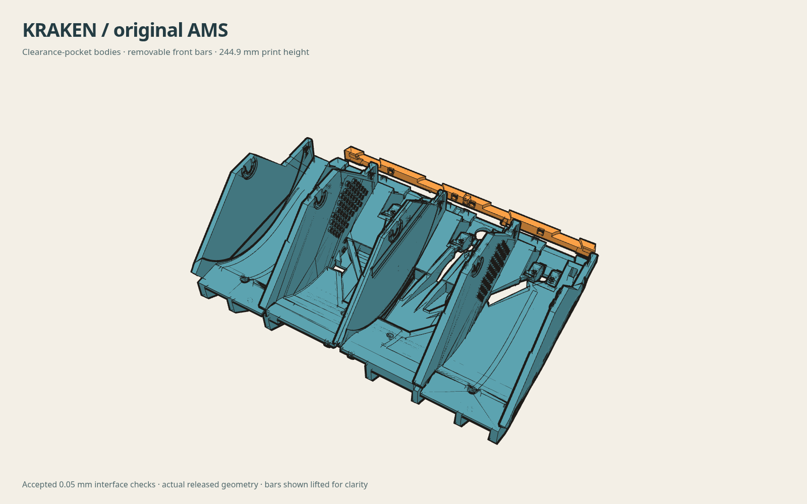
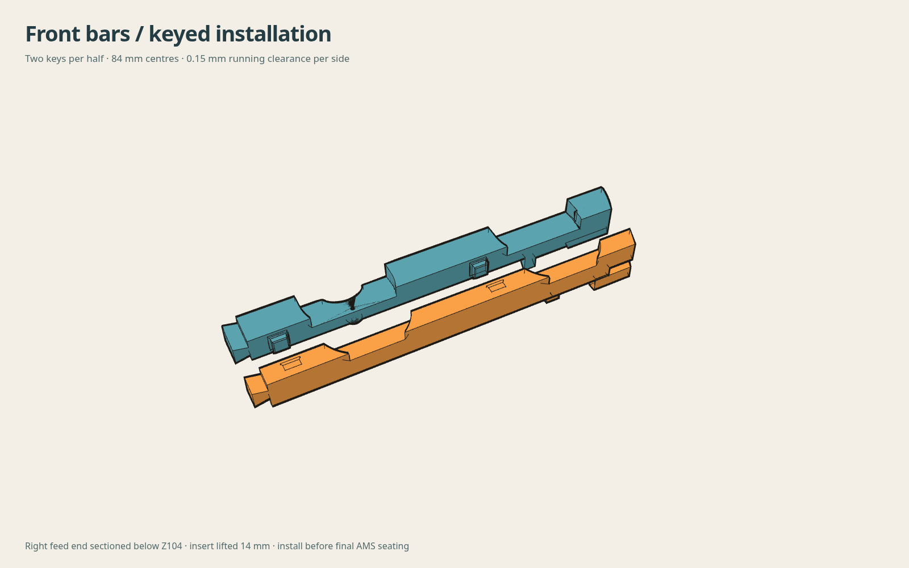
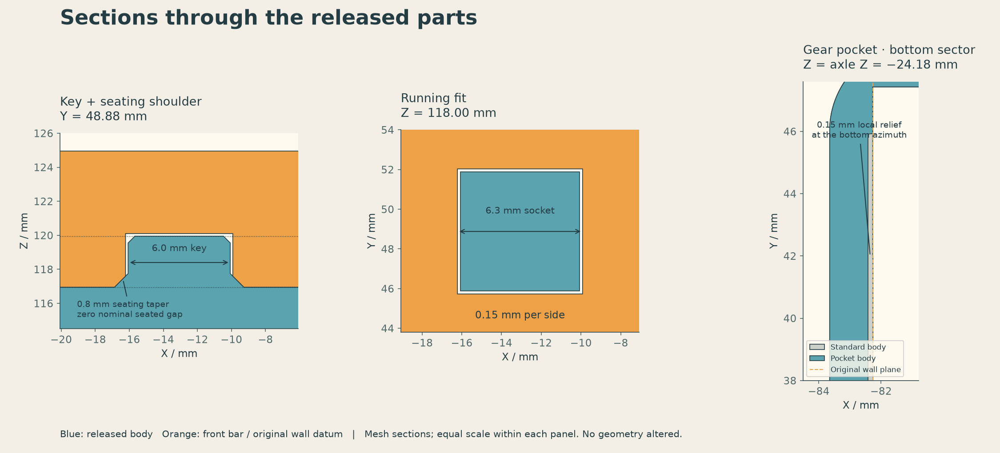
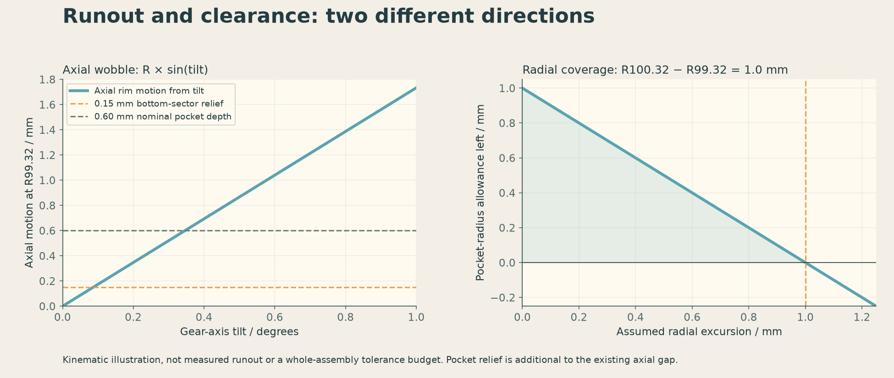

# Kraken body remix for the original Bambu Lab AMS

**Replacement left and right chassis halves for [Kraken by humebeam](https://www.printables.com/model/1788417-kraken-revolutionary-bambu-lab-ams), with extra clearance beside the large spool gears and removable end sections for assembly.**

Humebeam's Kraken replaces the original AMS's internal frame and supports each spool on a geared holder. This remix changes the two large printed bodies that hold those mechanisms. Each body carries two spool positions; the bodies join together to make the four-spool frame inside the AMS box.

If you are following humebeam's build guide, use the **four parts below in place of the two main printed bodies**. Continue using the original Kraken spool holders, gears, bearing parts and other accessories, together with the feeders, motor, electronics, tubing, cables and screws transferred from your AMS. Follow humebeam's parts list and instructions, with the front-bar installation difference explained below.

This repository targets the **original Bambu Lab AMS**. Its reference body files were `kraken-ams-left-100b.3mf` and `kraken-ams-right-100b.3mf`. It does not contain a complete Kraken kit or an AMS 2 Pro conversion.



Blue: the two main bodies. Orange: the two removable front bars, shown lifted away from their installed positions. The render uses the downloadable models.

## What changes, and why

**More space beside the large gear.** Each Kraken spool holder has a large gear that meshes with the small drive gear at its feeder. The large gear runs close to a body wall. This remix adds a shallow, tapered recess to that wall to give the gear rim more room if it moves toward the wall. We call that recess the **gear-clearance pocket**. It is separate from the bearing seats that locate the spool holder, and it does not change the gear teeth.

**A removable front end.** On each body, the end nearest the filament feeders becomes a separate **front bar**. Leaving the bars off gives more access around the feeder hardware during assembly. Each main body is also 5 mm shorter in its upright printing orientation: **244.9 mm instead of 249.9 mm**. Installing the bars restores the full assembled length and the end features that locate the frame in the AMS box.

The filenames describe both changes: **`pocket`** means the added gear-wall recess; **`cut5`** means the 5 mm reduction in main-body print height. The front bars are part of the finished assembly, not optional trim.

## Download the four replacement parts

You need **one of each**. Use the 3MF files in your slicer, or STEP if you want to inspect or edit the solid geometry. These 3MF files contain models only; they do not contain printer settings or ready-to-send toolpaths.

| Part | Slicer model | CAD solid |
|---|---|---|
| Right main body | [3MF](models/right-body-pocket_cut5.3mf) | [STEP](models/right-body-pocket_cut5.step) |
| Left main body | [3MF](models/left-body-pocket_cut5.3mf) | [STEP](models/left-body-pocket_cut5.step) |
| Right removable front bar | [3MF](models/right-front-bar-pocket_cut5.3mf) | [STEP](models/right-front-bar-pocket_cut5.step) |
| Left removable front bar | [3MF](models/left-front-bar-pocket_cut5.3mf) | [STEP](models/left-front-bar-pocket_cut5.step) |

Print the bodies upright, with the feeder end at the top of the print. Move each body's lowest face onto the build plate. The front-bar files are already positioned flat on their broad mating face, with the bottom at Z=0; each bar is 8 mm tall in that orientation. Use humebeam's guidance as your starting point for material and print settings, then inspect these models in your slicer.

**Spool-centering rings are different parts.** They fit the centre hole of the filament spool and snap onto the Kraken spool holder. They are not the orange front bars in the pictures. Obtain the rings and other holder parts from humebeam's model. A separate modified gear-side ring with a wider, thicker flange was also considered during this remix's development; that ring is not supplied here. The body-pocket dimensions describe the clearance added by these bodies alone, without assuming an extra clearance gain from a ring.

## How the front bars attach



Each body has **two square locating keys**, 84 mm apart. The matching front bar has two sockets that slide over them. The keys are 6.0 mm wide and the sockets are 6.3 mm wide, leaving **0.15 mm clearance on each side** while sliding. Chamfered key tips help the bar enter the sockets.

At the bottom of each key is a sloping seating surface. When the bar is fully seated, these matching tapers locate it sideways, while a broad, flat shoulder sets its height. The tapers have zero nominal gap when seated, so their printed fit matters. Check the bar fit and the sliding joint between the two main bodies before committing to the large prints.

Although the main body is 5 mm shorter, its bar is **8 mm thick**: 5 mm restores the missing end, and 3 mm overlaps the body to form the keyed joint. The bar carries the removed end's locating and clip features. Once the frame is finally seated, the original AMS box tabs are intended to retain it; no new retaining screw is added.



## Assembly difference from humebeam's guide

**Fit the front bars before locking the bodies into their final positions in the AMS.** They are not designed to be inserted or removed while the complete frame is already clipped and screwed firmly into the box.

The intended sequence is:

1. Check that the two main bodies slide together at their centre joint, and that each front bar seats on its keys. Remove printing burrs or first-layer flare without reshaping the locating surfaces.
2. Assemble the feeders, rollers and other hardware onto the bodies with the front bars absent, using humebeam's instructions. Route the PTFE tubes and cables.
3. Place the joined frame loosely in the AMS. Leave the front locating tabs disengaged and the body screws loose. Leave the main circuit board unfastened where its edge holders cross the body/bar split.
4. Slide each front bar onto its two keys until its flat underside rests on the body's shoulder. Both bars must be fully seated.
5. Engage the frame's front locating tabs with the AMS box, finish seating the frame, secure the circuit board and tighten the body screws according to the original guide.
6. To remove a bar later, first release the box tabs and any circuit-board retention that prevents movement. The bar needs about 3.15 mm of travel along its keys to disengage.

**This installation sequence still needs a complete physical assembly check.** The CAD checks cover the local joints and clearance around simplified hardware envelopes. They did not use a complete AMS enclosure or complete stock-feeder solids, so they do not establish whole-frame lowering/tilting clearance, hand access or final cable routing.

## What the gear pocket does—and does not do

The pocket is shaped around a nominal **99.32 mm gear-tip radius** and extends to a **100.32 mm radius**. Its nominal depth into the side wall is **0.6 mm**, with a 6° tapered transition. At the bottom of the gear, the recess is only **0.15 mm deep** so enough body wall remains. Those depths are additional local clearance, not the total gap between the installed gear and wall.

There are two different motions to consider. **Radial runout** is motion outward in the plane of the gear; it consumes the radius allowance. **Axial wobble** is side-to-side motion toward the body wall; it consumes the gap beside the gear. Extra radius allowance does not by itself cure axial rubbing. Spool centring, bearing seating and how tightly the holder clamps the spool also matter. Humebeam's guide specifically warns that overtightening can deform the large gear and cause rubbing.



The [engineering notes](docs/ENGINEERING.md) explain the dimensions and calculations behind these illustrations. They are geometric clearance calculations, not measured runout or a guarantee that every spool and holder assembly will run without contact.

## What has been checked

The mounting and mating features were checked digitally to **0.05 mm** against the selected reference measurements. For the two body assemblies supplied here, all **109 right-side and 101 left-side hardware checks passed**. The checks include screw locations, bearing/peg seats, board retainers, AMS locating faces and the joint between the halves. The separate bars were also checked for seating, local insertion travel and assembly interference.

The RFID-reader board pockets retain a strict material-preservation check: the exporter refuses a model that adds material inside the protected reference pocket. This guards the space needed to slide in and retain the boards.

The downloadable models were also reproduced from the included CAD source and compared with the release files. See [validation scope and limits](docs/VALIDATION.md), [reproduction results](docs/REPRODUCTION.json) and [file identities](docs/RELEASE.json). **The 0.05 mm figure describes the CAD checks, not achievable accuracy from a filament printer.** A complete body print and full AMS installation have not been certified by this release.

## Rebuild or edit the CAD

You can use the downloads without running Python. For editing or regenerating them, the source was tested with Python 3.12 on Linux and the versions in [requirements.txt](requirements.txt):

```sh
python3.12 -m venv .venv
. .venv/bin/activate
python -m pip install -r requirements.txt
OPENBLAS_NUM_THREADS=1 python rebuild.py --output build
```

This produces the same four parts under `build/models/`. It builds the bodies and their keyed splits directly in native CAD, applies the RFID pocket check, and exports STEP and 3MF. Choose a new output directory for each run; the script refuses to overwrite an existing one.

For a version with the same shortened bodies and front bars **but without the added gear-wall recess**, use:

```sh
OPENBLAS_NUM_THREADS=1 python rebuild.py --variant standard --output build-standard
```

`standard` is the code's name for that alternative; it is not humebeam's original mesh. The downloadable files and the reproduction comparison in this repository are the `pocket` version.

Body dimensions are in [cad/right.py](cad/right.py), with the left-hand differences in [cad/left.py](cad/left.py). The removable-bar joint dimensions are in [cad/feed_end_insert.py](cad/feed_end_insert.py). The two NPZ files under `cad/reference/` contain geometry used only to check the protected RFID pocket. The body shapes are built from CAD features, not traced mesh outlines.

To verify the downloaded files and compare a default rebuild with them:

```sh
sha256sum -c SHA256SUMS
python verify.py --build build
```

STEP headers and ZIP timestamps may differ on regeneration. The second command compares the actual solid and mesh geometry. Changing parameters requires new fit and clearance checks; the published results apply to the supplied dimensions.

## Credit and license

Original Kraken design and assembly guide: **humebeam**, [Kraken – Revolutionary Bambu Lab AMS](https://www.printables.com/model/1788417-kraken-revolutionary-bambu-lab-ams). Remix: **thereprocase**. This remix adds the body-wall clearance pockets, removable front bars and editable native CAD reconstruction. It is not endorsed by the original designer.

[CC BY-NC 4.0](https://creativecommons.org/licenses/by-nc/4.0/): attribution and noncommercial use are required. See [LICENSE.md](LICENSE.md).
