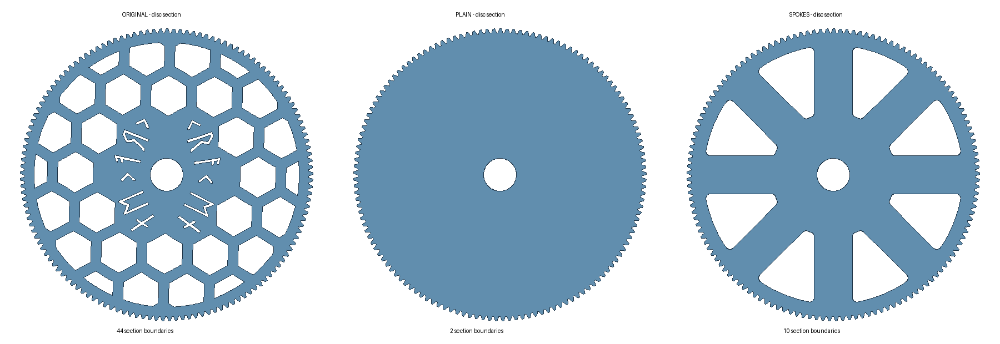

# Eight-spoke spool gear

An optional replacement for the large spool gear in [humebeam's original Kraken AMS](https://www.printables.com/model/1788417-kraken-revolutionary-bambu-lab-ams). Eight broad radial spokes replace the small web openings, reducing interrupted toolpaths while keeping the supplied teeth, hub, shaft, threads, shoulders and bearing-seat facets exactly.



The right-hand eight-spoke design is supplied here. The middle plain disc is a comparison reference in the image. Print one gear per spool position being replaced; use the original Kraken holder, bearings and assembly instructions.

## Download

| File | Purpose |
|---|---|
| [gear-spokes.3mf](models/gear-spokes.3mf) | Complete gear geometry for your slicer; no printer settings or toolpaths |
| [gear-spokes.stl](models/gear-spokes.stl) | Same complete gear as STL |
| [gear-spokes.step.gz](models/gear-spokes.step.gz) | Complete faceted STEP, gzip compressed; decompress before importing |
| [gear-spokes-analytic-web.step](models/gear-spokes-analytic-web.step) | Analytic web construction only; a CAD reference rather than a complete printable gear |

The complete STEP is approximately 176 MiB uncompressed because every original mesh facet is represented as a face. The teeth and threads remain source-mesh geometry. The web has parametric analytic construction; the complete gear is not an analytic tooth/thread reconstruction.

## What changed

The disc remains 4.0 mm thick; the complete gear remains about 71.9 mm tall with 137 double-helical teeth and approximately 99.319 mm tip radius. Eight 26 mm-wide spokes connect a radius-42 mm hub pad to a continuous outer rim. The windows have 3 mm corner fillets and reach radius 88 mm. All changes lie inside radius 90.002 mm and within the original disc's Z0–4 mm envelope.

Exact-facet checks retain 20,953 tooth-engagement triangles, 28,877 hub/shaft/thread/shoulder triangles and 6,572 bore/bearing-seat triangles. These groups overlap. The source and delivered gear are single-component closed meshes; bearing seats and material above the disc are unchanged. See [interface evidence](evidence/INTERFACES.json).

The intermediate spool-contact pattern changes. The central pad and outer annulus remain, but unusual spool-flange projections or undocumented access through the original web openings need a physical check.

## Print comparison

Controlled slices used the same PETG recipe: 0.20 mm layers, five walls, five top/bottom layers, 50% rectilinear, 5,000 mm/s² print/travel acceleration, 250°C, 0.3 mm retract, flow ratio 0.931 and 32 mm³/s cap; brim, supports and tower disabled. These are comparison settings, not a universal filament calibration.

| Whole-gear job | Original | Eight spokes |
|---|---:|---:|
| Estimated time | 3h28m57s | 2h49m59s |
| Estimated filament, including purge | 95.18 g | 103.48 g |
| Disc negative-E cycles | 2,243 | 561 |
| Layer 20 negative-E cycles | 585 | 212 |

That is about **19% less estimated time, 75% fewer disc retract cycles and 8.7% more job filament**. Counts include emitted negative-E routines and are not a calibrated jam-risk measurement. This controlled comparison predates the later custom retraction limiter; it isolates the geometry change. Physical printing is in progress; a complete fit or durability qualification is pending.

Print with the broad disc on the plate. Review the bearing fit in your own material. A +0.10 mm hole-diameter allowance used for one PETG trial was applied separately in the slicer as +0.05 mm XY hole compensation; it is absent from these geometry files and affects every closed hole when enabled.

## Comparative stiffness

The refined linear model predicts minimum candidate/original stiffness ratios of **1.441 in torsion and 1.452 in out-of-plane bending** across 52 paired load cases and three core-modulus assumptions. This corresponds to about 31% less deflection under the same modeled load. The 0.75-to-0.5 mm grid refinement changed paired ratios by at most 0.84%.

The model uses common hypothetical PETG properties (E=2,000 MPa, Poisson ratio 0.38), a hub clamp at R≤18 mm and rim loading at R93–95.5 mm. Solid skins and a reduced-modulus core approximate the print. Actual rectilinear paths, layer anisotropy, residual stress and bearing compliance are unresolved. These are conditional stiffness predictions; strength, creep, fatigue, impact and physical bearing fit require testing. See [complete numerical results](evidence/STIFFNESS-SUMMARY.json), [plate checks](evidence/solver-benchmarks.json) and [membrane checks](evidence/membrane-benchmarks.json).

## Source and reproduction

[source/](source/) contains the unchanged frozen web builder, retained-interface assembly, mesh exporters, checks and stiffness solver. Dependencies use the same pinned versions as the body rebuild. The original attributed gear mesh is included as a reconstruction input at `source/reference/original-gear.stl`; its SHA256 is `e56cd06d14cc3cfb552dd9d6584f5049298e3480ca1ba61dfe9e44b1dbd09a9d`. It is included for provenance and regeneration. The recommended printable replacement is the eight-spoke file above.

Work in a scratch copy with the dependency environment described in the repository README:

```sh
cp -R gear/source gear-build
cd gear-build
mkdir -p artifacts analysis
OPENBLAS_NUM_THREADS=1 python gear_web.py all
OPENBLAS_NUM_THREADS=1 python check_interfaces.py
OPENBLAS_NUM_THREADS=1 python export_faceted_step.py spokes
```

`all` also constructs the plain reference so the original comparative interface checker can inspect both. Only the eight-spoke replacement is distributed in `gear/models/`. Full faceted STEP conversion can take substantial time and memory. Optional numerical checks:

```sh
OPENBLAS_NUM_THREADS=1 python check_solver.py
OPENBLAS_NUM_THREADS=1 python stiffness.py --grid 0.5 --core 1 .5 .25
```

Run the finest matrix alone on a memory-limited machine. Edited parameters require renewed validation. The original and supplied mesh hashes and compressed STEP identity are in [FILES.json](evidence/FILES.json); root `SHA256SUMS` covers the published package. No ready-to-send print jobs are included.

Original gear: **humebeam**. Web remix: **thereprocase**. Distributed under the repository's [CC BY-NC 4.0 license](../LICENSE.md).
