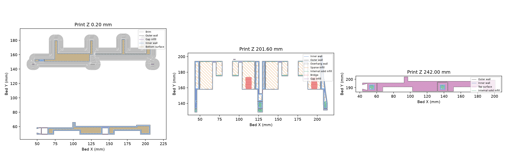
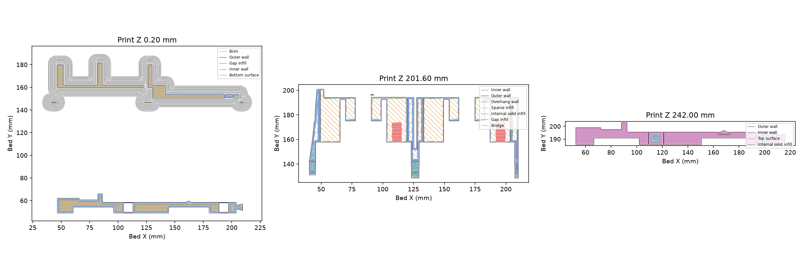

# ASA body and front-bar print package

**Two plates, about 562 g total.** Each plate contains one upright body and its matching flat front bar. These projects use the isolated v4 printable-underside revision, with the accepted hardware interfaces and cut5 joint retained. Existing model-only releases remain unchanged.

[Project website and illustrated instructions](https://thereprocase.github.io/kraken/) · [Complete print package](https://github.com/thereprocase/kraken-remix-ogAMS/releases/download/asa-print-2026-10-16/kraken-asa-print-package-2026-10-16.zip) · [Detailed print and assembly notes](PRINT-NOTES.txt)

## Download and print

| Plate | Ready-sliced project | Estimated time | Estimated ASA |
|---|---|---:|---:|
| Left body + front bar | [Left 3MF](https://github.com/thereprocase/kraken-remix-ogAMS/releases/download/asa-print-2026-10-16/kraken-left-asa.3mf) | 12h44m | 281.63 g |
| Right body + front bar | [Right 3MF](https://github.com/thereprocase/kraken-remix-ogAMS/releases/download/asa-print-2026-10-16/kraken-right-asa.3mf) | 12h47m | 280.78 g |
| Four 84 mm fit coupons | [Fit-check 3MF](https://github.com/thereprocase/kraken-remix-ogAMS/releases/download/asa-print-2026-10-16/kraken-asa-alignment-check.3mf) | 52 min | About 12 g |

These are **P1S / 0.4 mm hardened-steel / Polymaker ASA** projects, including G-code and editable modifiers. Confirm your machine, nozzle, material and AMS mapping before printing. The swatch is not a physical slot assignment. Use a clear, clean textured plate. Other printers require reslicing and review. Reslicing with stock Orca may lose the custom retraction-frequency behavior; the supplied G-code already contains it.

1. Print the small fit-check plate first where practical. Both keys must seat together by hand, with the shoulders flush.
2. Open each body project separately. Keep the upright body, flat bar and modifiers together; the body is 244.9 mm tall. Use the supplied slice for the documented P1S setup.
3. Keep the enclosure stable through the heat soak and print. Let the whole plate cool naturally before removal.
4. Inspect the cooled locating faces and socket roofs. Dry-fit both halves, hardware, routing and front bars before final tightening. Never use screws to straighten a warped body.
5. Add spools progressively, check rotation and feeding in every bay, then recheck seating after 24 hours.

## Where the material goes

Bodies use **2 walls / 15% rectilinear infill**. Embedded modifier volumes increase seat, fastener and key roots to **4 walls / 100%**, with selected wall paths at **4 walls / 15%**. Dense modifiers take precedence where they overlap. Front bars use **4 walls / 30%** throughout. The saved projects retain those settings after reopening.

The v4 underside uses simple ramps, narrower feeder channels and a roof over the existing cable entry to remove the problematic broad unsupported ledges. The hardware locations, RFID pocket guard, locating faces, front-bar joints and load-analysis strips are preserved. Model-only v4 exports: [left](left-body-v4-model.3mf), [right](right-body-v4-model.3mf). Use the existing accepted front bars with these bodies.

## Settings

| Control | Value |
|---|---|
| Nozzle / textured bed | 260 / 95 °C; 10-minute startup heat soak |
| Layer height | 0.20 mm, including first layer |
| Flow ratio / volumetric cap | 0.95 / 12 mm³/s |
| Print and travel acceleration | 5,000 mm/s² cap; first layer 500; top surfaces 2,000 |
| Body adhesion | 8 mm outer brim, 0.15 mm gap; bars have no brim |
| Supports / prime tower | Off / off |
| Cooling during deposition | Part 0–20%, overhang 30%; aux and chamber exhaust off |
| Retraction | 0.8 mm; soft guard 3 cycles per 1 mm fresh filament; hard minimum 0.3 mm fresh extrusion |
| Shrink / hole compensation | 100% / zero; no global scaling from hole fit |

Exact profiles: [machine](machine.json), [process](process.json), [filament](filament.json). Full package contains checksums, comparisons, path checks, previews and engineering evidence. [Download identities](DOWNLOADS.json).

## Evidence and physical limits

Hardware checks pass at the documented 0.05 mm CAD scope: **109/109 right and 101/101 left**. The accepted release and reinforcement masks remain unchanged. Final projects pass oriented-triangle, modifier, reopening, temperature, cooling, acceleration and retraction checks. The largest screened straight bridge free interval is 5.95 mm with geometric anchors at both ends; short infill endpoints inside earlier wall paths were reviewed separately.

The net-section screen supports local reinforcement for an unheated indoor AMS with up to two 2 kg spools per half under the stated load assumptions. Whole-body FEA did not converge, so no physical stiffness gain or safety factor is claimed. The two body plates total **562.41 g**; this is a slicer estimate and includes their front bars and brims. The package contains matched baseline/local/reference comparisons for the earlier accepted geometry; those are distinct from the final v4 paired-plate estimates.

This is ready for a **first full-size print and fitting**. Full-height ASA warp, bridge sag, full-box installation and long-term creep still require physical acceptance. The small coupons cannot reproduce full-body distortion. See [CAD review](CAD-VALIDATION.md) and the [complete checklist](PRINT-NOTES.txt).

Original Kraken design: [humebeam](https://www.printables.com/model/1788417-kraken-revolutionary-bambu-lab-ams). This remix targets the original Bambu Lab AMS. Existing [license and attribution](../../LICENSE.md) apply.
