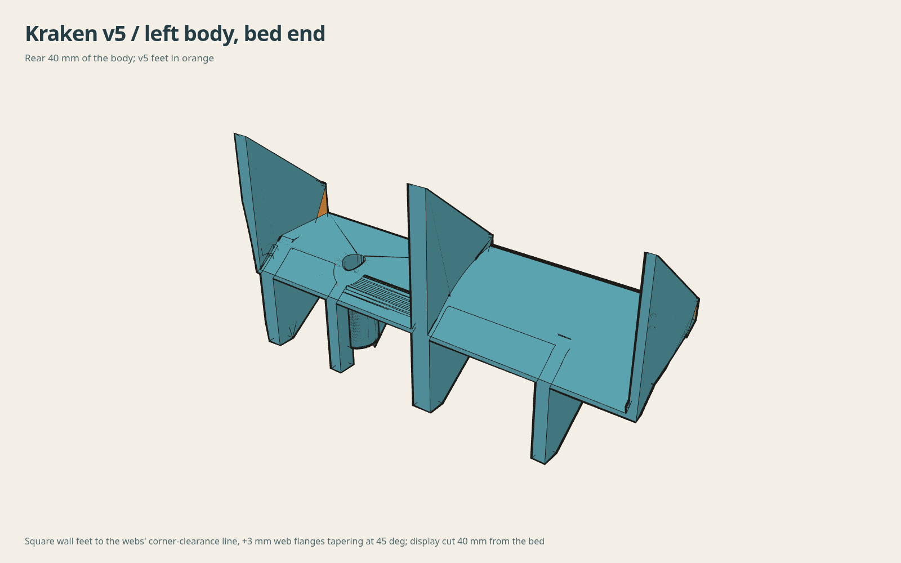
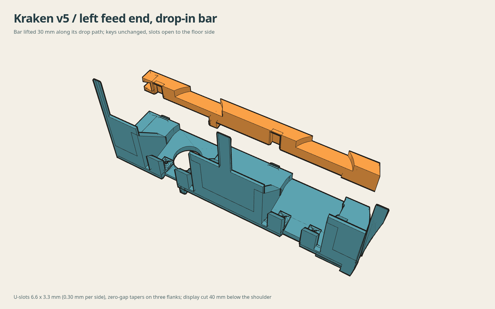
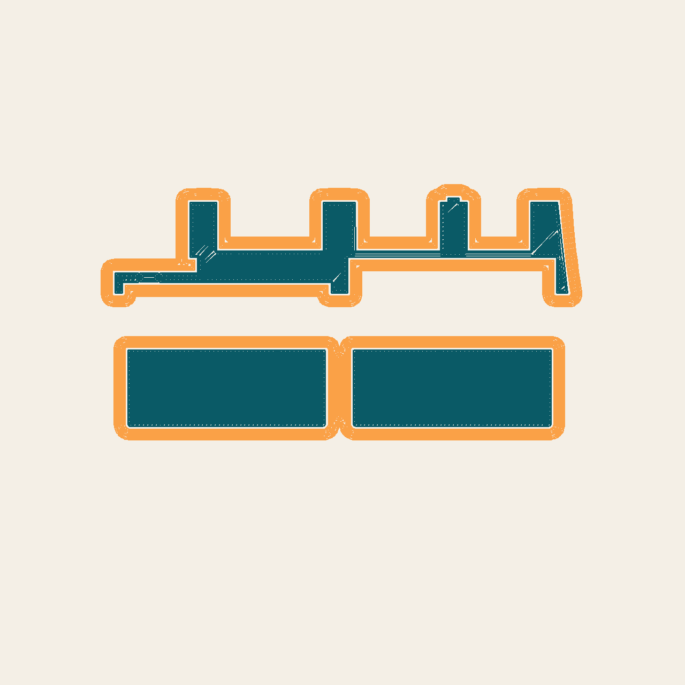

# v5 bodies and drop-in front bars

**Two bodies with square bed-end feet and two bars that drop onto the keys from above.** The v5 bodies are the v4
printable-underside bodies (release asa-print-2026-10-16) plus a designed rear face; the bars keep the released keys and
replace the blind sockets with floor-open U-slots. Hardware interfaces, cut5 keys, gear pocket, RFID pocket and the v4
underside are unchanged. STEP and geometry-only 3MF for every part are in this folder.

## Why the bed face changed

The first PCTG print of the v4 left body curled at layer 6. Its bed face was 1415 mm2 in five islands: the two bay lip
skins and three 1.4 mm wall pads, because the native rebuild gave the end, middle and seam walls sloped leading edges
that reach full section only 2 to 6 mm above the bed. humebeam's walls are square to the bed down to the box-corner
clearance line, 1640 mm2 in one region. v5 gives each wall a square foot down to the line the support webs already use
(front_support_y 38.71, 34.34 degrees to the floor), and widens the four webs and the rib by 3 mm per side at the bed with
a 45 degree taper over 3 mm.

| Bed face at print Z 0.15 | humebeam | v4 | v5 |
|---|---:|---:|---:|
| Left | 1640 mm2, 1 region | 1415 mm2, 5 islands | 2026 mm2, 1 region |
| Right | 1249 mm2, 1 region | 1016 mm2, 5 islands | 1516 mm2, 1 region |

Added per body: end wall foot about 0.9 cm3 (after the AMS side envelope trims it), middle wall foot 3.1 cm3, seam wall
foot 0.07 cm3, web flanges 0.08 to 0.17 cm3 each, plus two fills from the owner's slice review: the middle support web
widened 2.65 mm to the cap-bay wall face from the bed end to 5 mm before the RFID pocket entry (2.9 cm3), and the seam
wall filled beside its 1.25 mm toe from Y 44 down to the 1.4 mm floor relief over the seam support run (3.0 / 2.2 cm3).
Both close slots that v4 carried (2.65 mm beside the web, 2.3 mm beside the seam toe). Nothing is removed. Everything added sits below print Z 35 and above
Y 4.24 (native), on the same corner-clearance line and Y band as humebeam's own walls and our own webs.

## Drop-in bars

| Item | Value |
|---|---|
| Keys (on the body) | unchanged: 6.0 mm square, 3.0 mm tall, 0.8 mm 45 degree root collar, 0.4 mm tip lead, 84 mm centres |
| Slot | 6.6 mm wide, 3.3 mm deep from the shoulder face, open through the platform underside |
| Running clearance | 0.30 mm per side on the X flanks (owner's P1S ladder: 0.3 slides, 0.2 forces) |
| Seat tapers | zero-gap 45 degree tapers on the two X flanks only |
| Vertical clearance | closed flank follows the key collar 0.70 mm above it: the bar rests on the box floor, never on the keys, and can be pushed a hair past the key position by hand |
| Retention | box front tabs in the bar's existing 4.8 x 3 mm clip slot after a 3 mm forward slide of the joined assembly |
| Print pose | flat, shoulder face down, as the released bars; slots print as 6.6 mm open trenches |

Install: join the halves, lower them into the box without the bars and push them to the rear; drop each bar onto its
keys; slide the assembly 3 mm forward so the tabs enter the bar slots; box screws; routing; main board last (it goes under
its edge tabs after the bars, and comes out first). This assumes at least 3.3 mm of free box depth with the bars on;
the owner's box measurement is still to come.

## Files

| Part | STEP | 3MF (model frame) |
|---|---|---|
| Left body v5 | [left-body-v5.step](left-body-v5.step) | [left-body-v5-model.3mf](left-body-v5-model.3mf) |
| Right body v5 | [right-body-v5.step](right-body-v5.step) | [right-body-v5-model.3mf](right-body-v5-model.3mf) |
| Left bar v5 (flat print pose) | [left-front-bar-v5.step](left-front-bar-v5.step) | [left-front-bar-v5-model.3mf](left-front-bar-v5-model.3mf) |
| Right bar v5 (flat print pose) | [right-front-bar-v5.step](right-front-bar-v5.step) | [right-front-bar-v5-model.3mf](right-front-bar-v5-model.3mf) |
| Bars in assembly coordinates | [left](left-front-bar-v5-assembly.step), [right](right-front-bar-v5-assembly.step) | |

Body 3MFs are in native coordinates with no transform, the same frame as `left-body-v4-model.3mf` (Z -124.95..119.95);
place them as the v4 release did (identity rotation, Z +124.95 to the bed). The released reinforcement masks apply unchanged (reclip check: 0 mm3 of every mask lies outside the v5 solids), with
the same placement as the v4 release. Bars print with 4 walls / 30 % and no modifiers.

## Narrow slots that belong there

Seen from the floor side the bodies show several thin slots. They are hardware pockets, identical in the v4 release and
in humebeam's original, and must stay open: the 1.8 mm RFID board slot between the two skins of the middle wall (open at
the floor side, the board slides in from below), the 2.91 mm slots under the main-board edge tabs at the feed end, the
4.8 mm box clip slot, the 2.8 mm box-screw clearance inside the cap-bay rib, the 1.8 mm pilot bores of the hub posts,
the feeder locator sockets, the roller seat mouths and, on the right body, the ferrite rails. A gap scan (`source/newgaps.py`)
finds no gap under 4 mm on the tub side of either body below the RFID pocket other than the 1.4 mm seam-toe floor relief.

## Reproduction

Bodies: the attic v4 pipeline reproduction (`source/build_candidate.py` on the accepted cut5 STEP) followed by
`source/rear_face_v5.py SIDE --out DIR`; both read the accepted artifacts of the 2026-10-16 workspace, which is not in this
repository. Bars: from this repository alone, `cad/feed_end_insert.py SIDE pocket --fit-clearance 0.30 --drop-in 0.70`
(native build; the left bar rebuilt this way matched the released file with 0.0 mm3 symmetric difference). Checks:
`source/run_checks.sh`, `source/deviation_check.py`, test slice `source/prepare_v5.py`.

## Printing

Recipe for the first PCTG print, from the lead's 2026-10-28 slice: 0.6 mm nozzle, 0.3 mm layers, 2 walls / 15 %, dense
masks 4 walls / 100 %, wall masks 4 walls / 15 %, 30 mm/s first layer, humebeam's stackable support boxes beside the
wings, no support, and the owner's safety brim: outer brim, 0.5 mm object gap, 5 mm wide. The bars go on a separate plate
in a contrast colour. Test-slice results are in [CAD-VALIDATION.md](CAD-VALIDATION.md); the first layer of the left test slice:

### Sliced P1S projects (release pctg-print-2026-10-28)

The release carries one sliced project per body, made with the recipe above in Orca (d80c fork) with the owner's
profiles: Repro P1S 0.6 nozzle, Repro Normal 0.6 process, filament preset 3D-Fuel Pro PCTG Matte 0.6 (260 C nozzle,
70 C plate, 17 mm3/s cap, 99.66 % XY shrink compensation, chamber heat soak in the start G-code). Outer walls run at
60 mm/s to stay below the 80 to 150 mm/s band where the P1S shows vertical fine artifacts.

| Project | Layers | Slicer estimate | Filament |
|---|---:|---:|---:|
| `kraken-left-v5-pctg-matte-06-outer60.gcode.3mf` | 816 | 12 h 26 min | 498 g |
| `kraken-right-v5-pctg-matte-06-outer60.gcode.3mf` | 816 | 12 h 22 min | 494 g |

The left project started printing on 2026-10-28; no v5 body has finished printing yet, so warp, fit in the box and
the drop-in bar fit are physical checks still open. Check your nozzle, plate and AMS slot before sending.

Original Kraken design: [humebeam](https://www.printables.com/model/1788417-kraken-revolutionary-bambu-lab-ams). Existing
[license and attribution](../../LICENSE.md) apply.
