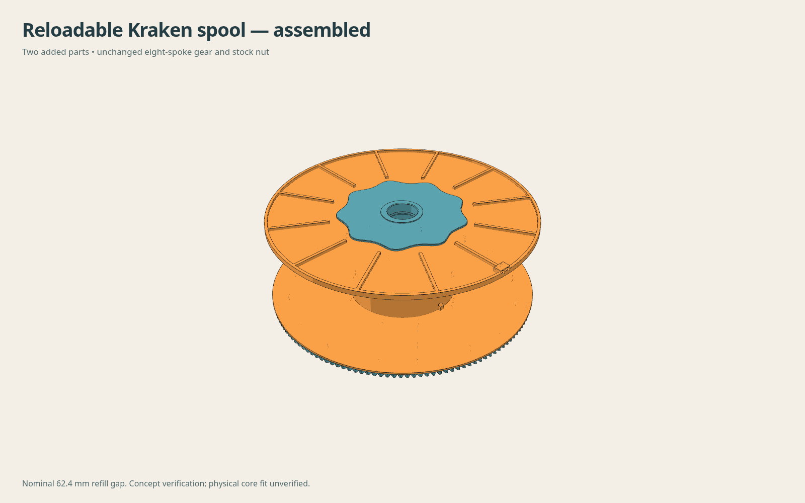

# Reloadable refill spool for Kraken — prototype

Two added parts let [humebeam's Kraken AMS](https://www.printables.com/model/1788417-kraken-revolutionary-bambu-lab-ams) carry a Bambu 1 kg filament refill on **one existing regular eight-spoke gear**. A smooth backing and keyed sleeve support the cardboard core; a removable smooth flange is retained by the original stock nut, inverted. Teeth, shaft, threads, bearing seats and nut are unchanged.

**Not ready-to-use: installed drive-gear/backing clearance is UNVERIFIED.** No installed OEM drive-gear/hub solid or verified axial envelope was available. The prototype passes the available body, thread, tool and export checks, but needs that installed check, an actual cardboard-core fit test and a clamping/slip test before operation. It does not claim verified Bambu cardboard tolerances or physical strength.



## Added parts to print individually

| Part | STEP | STL | Geometry-only 3MF |
|---|---|---|---|
| Backing with sleeve and core key | [STEP](artifacts/backing-sleeve.step) | [STL](artifacts/backing-sleeve.stl) | [3MF](artifacts/backing-sleeve.3mf) |
| Removable flange with tail parking | [STEP](artifacts/removable-flange.step) | [STL](artifacts/removable-flange.stl) | [3MF](artifacts/removable-flange.3mf) |

Both files have their flat face at Z0 and their sleeve/ribs pointing upward. They are designed without broad unsupported roofs; slicing and physical printing are still untested. The tiny horizontal tail holes need normal small-hole print capability. Material assumption is PETG, matching the gear; no printer profile, G-code or dryer-temperature rating is included.

Use the [existing unchanged eight-spoke gear](https://github.com/thereprocase/kraken-remix-ogAMS/tree/main/gear), original Kraken nut, bearings and peg holders. **Keep refill bands intact until both flanges are secured.** Follow the [loading sequence, BOM, dimensions and limitations](REPORT.md).

## Review the assembly

- [Exploded view](renders/exploded.png) and [axial section](renders/section.png).
- [Full assembly 3MF](artifacts/assembly-reference-NOT-FOR-PRINT.3mf) or [STL](artifacts/assembly-reference-NOT-FOR-PRINT.stl): **reference only; do not print this assembly as one part.**
- [New-parts assembly STEP](artifacts/added-parts-assembly.step): only the two added analytic solids, in assembled coordinates.
- The complete retained gear STEP is the [existing faceted STEP](https://github.com/thereprocase/kraken-remix-ogAMS/blob/main/gear/models/gear-spokes.step.gz). Its large file is not duplicated here. [Assembly placement](analysis/assembly-placement.json) records how the unchanged gear and nut are registered.

The nominal refill face gap is 62.4 mm; sleeve OD81.7 mm follows the official Bambu plastic reference. The prototype accommodates an intended 60–62.4 mm core-width range through nut adjustment. Real cardboard ID, wall and notch tolerances remain assumptions. The top flange's two tail holes sit outside the winding face.

## Regenerate and check

Work in a scratch copy, using the repository's existing CAD environment. No package installation is performed by these scripts. Recorded versions are in [REPRODUCTION.json](analysis/REPRODUCTION.json).

```sh
cp -R reloadable-spool /tmp/reloadable-spool-build
cd /tmp/reloadable-spool-build
export KRAKEN_GEAR=/absolute/path/to/kraken-remix-ogAMS/gear/models/gear-spokes.stl
OPENBLAS_NUM_THREADS=1 python reproduce.py
```

`reproduce.py` builds both analytic parts, solves retained nut registration, checks the helical and axial assembly paths and stock tool, exports the reference assembly, rereads native STEP/STL/3MF and checks unchanged source hashes. It uses the included original nut/tool fixtures. Edit [parameters.json](parameters.json) for named design dimensions, then repeat the complete check. Thread registration uses [measured source axes](analysis/interfaces.json), not bounding-box centers.

To repeat the public body-envelope checks:

```sh
OPENBLAS_NUM_THREADS=1 python check_published_bodies.py --repo /absolute/path/to/kraken-remix-ogAMS
```

For renders, an existing Node runtime with native WebSocket and Chromium are needed. `render_support/` contains the deterministic renderer; no package download is needed:

```sh
OPENBLAS_NUM_THREADS=1 python capture_previews.py
```

Render copies retain the exact input positions and facets; per-triangle normals, a narrower camera depth range and depth-tested contour passes reduce thin-plate artifacts. The section is a capped Boolean on disposable copies. Renders are illustrative, not dimensional evidence.

The source measurement files were made from the official Bambu references listed in [SOURCES.json](SOURCES.json). Their original STLs are **excluded** because redistribution rights have not been established. The included numerical evidence is sufficient to reproduce the two added parts; remeasuring the Bambu reference requires obtaining those files separately. Historical body checks in `analysis/body-envelope.json` identify archived inputs by filename and hash; the public-body checker above uses current repository geometry instead.

STEP headers and ZIP timestamps may differ on regeneration; native validity, geometry, source-facet retention and measured clearances are the reproduction criteria. [SHA256SUMS](SHA256SUMS) identifies this frozen prototype delivery.

## Credit

Original Kraken hardware and source gear/nut/tool: **humebeam**. Eight-spoke gear remix, refill-carrier design, checks and renders: **thereprocase**. Bambu reusable-spool geometry was used as a dimensional reference, not redistributed or traced into the CAD. Attribution does not imply endorsement or physical testing by either original designer. This package follows the repository's **CC BY-NC 4.0** license.
