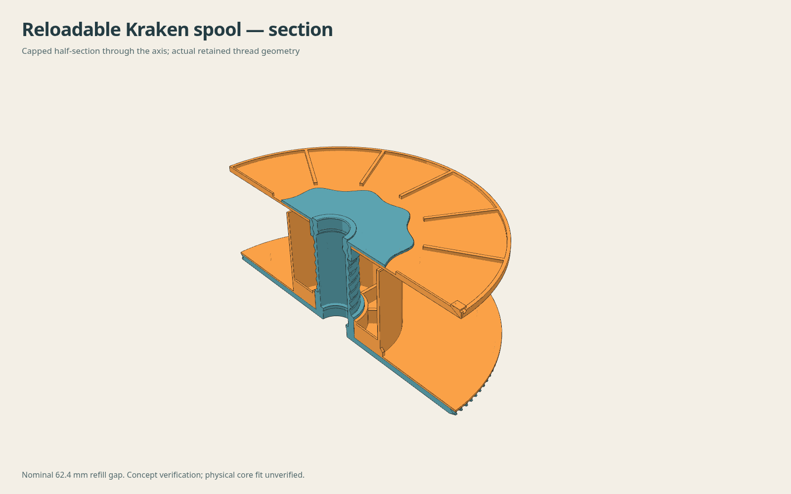

# Reloadable Kraken spool prototype

**Prototype for fit testing; not ready-to-use or installed-clearance certified.** Two added parts turn one unchanged eight-spoke Kraken gear into a refill carrier. The unavailable installed OEM drive-gear/hub envelope is an explicit acceptance blocker: the added backing must be checked at the actual gear mesh before operation. Physical Bambu refill fit, clamping friction and durability remain unverified.

This builds on [humebeam's Kraken AMS](https://www.printables.com/model/1788417-kraken-revolutionary-bambu-lab-ams) and thereprocase's [existing eight-spoke gear](https://github.com/thereprocase/kraken-remix-ogAMS/tree/main/gear). It uses exactly one regular gear, its unchanged threaded shaft, the stock nut and original bearing/peg hardware. The gear is linked, not replaced or duplicated as another huge STEP. The two new parts are analytic CAD; the retained gear, nut and tightening tool are original mesh surfaces, not claimed analytic reconstructions.

## Parts and dimensions

| Quantity | Part | Function | Native solid volume |
|---:|---|---|---:|
| 1 | Backing/sleeve | Smooth filament face over the eight windows; core support; end-notch key; lower hub centering | 71.945 cm³ |
| 1 | Removable flange | Smooth opposite filament face; stock-nut clamp; outer ribs; paired tail holes | 53.270 cm³ |
| 1 | Existing eight-spoke gear | Unchanged drive teeth, hub, shaft and bearing seats | Existing gear |
| 1 | Stock Kraken nut | Inverted, with barrel inside the cardboard core and broad flange outside | Existing nut |
| — | Existing bearings and peg holders | Original Kraken axle hardware and installation | Unchanged |
| 1 | Bambu 1 kg refill | Cardboard core, notch and filament | Owner-supplied; tolerances unverified |

The two new parts total **125.215 cm³ of CAD solid**. This is geometry volume, not sliced extrusion, print time or a mass prediction. PETG matching the gear is the provisional material assumption. No new strength/FEA, dryer-temperature qualification, slicer profile or print job is supplied.

Main editable drivers are in `parameters.json`: D200 flanges; D81.7 sleeve with 2 mm wall; 60–62.4 mm intended core-width range; 0.15 mm radial sliding clearance around the stock D36.25 barrels; 1.2 mm backing; 1.6 mm opposite face; R54 rib start for tool clearance. The tail lug is on the outer face, stays inside D200, and has two radial Ø2.2 mm holes at 5 mm pitch. The filament-facing plane has no tail holes, raised ribs or parking bumps.

The core notch key is 3.2 mm wide and 5 mm long. Its 45° tip ramp and 2.0 mm radial projection follow the assumed core wall: the tip remains 0.15 mm below the assumed cardboard OD. This is deliberately not a traced Bambu outline. The source plastic key reaches approximately R43.7 and is about 3.46 mm wide at its tip. Real cardboard notch and wall dimensions still need checking.

## Axial stack and engagement

Gear-local Z, with the unchanged disc bottom at zero:

| Element | Z range, mm |
|---|---:|
| Retained gear disc | 0–4.0 |
| Smooth backing | 4.0–5.2 |
| Nominal refill space | 5.2–67.6 |
| Core sleeve | 5.2–64.4 |
| Opposite flange face plate | 67.6–69.2 |
| Exterior ribs / tail-lug maximum | 71.2 / 72.4 |
| Inverted nut barrel / broad flange | 58.8–69.2 / 69.2–70.7 |
| Unchanged shaft tip | 71.899994 |

The source nut axis is **X−0.000528, Y−1.210936 mm**, derived from three outer-barrel circle fits. Bounding-box centering would misregister it by about 1.21 mm. Its measured flange thickness is 1.5 mm. A rigid flip, axial placement and thread clocking preserve every source facet.

Actual thread sections give approximately 6.0 mm pitch. At the nominal stack the nut overlaps 11.9 mm axially, about 1.98 turns including the end regions, and the shaft tip stands 1.20 mm above the nut. This is not a claim that two perfect full turns carry load. The core sleeve ends 3.2 mm short of the opposite inner face, reducing to 0.8 mm at the 60 mm minimum width, so the sleeve does not prevent the cardboard being retained.

Compatible phases at 60, 61.2 and 62.4 mm core widths have zero gear/nut mesh Boolean intrusion and about 0.09 mm minimum sampled radial clearance. The nominal clearance-centred phase is 280.74244° after the rigid flip. At fixed seating depth, sampled thread flanks approach first contact after about −11.35° or +10.36° from that phase. Those are geometric contact bounds, not clamping-force or stress results. Printed fit and tightening torque are unknown.

The stock nut's nominal seating face has a 0.010968 mm³ Boolean overlap with the new flange spread over **only 0.00000203 mm axial depth**, caused by the source float32 face coordinates around the nominal 1.5 mm plane. It is classified explicitly as coincident contact within 0.00001 mm, not removed by a CAD adjustment. Every other part pair has zero overlap within numerical precision.

## Checks and limits

| Check | Result | Scope / limit |
|---|---|---|
| Native STEP reread | PASS | Both new parts remain one valid solid |
| STL / 3MF | PASS | Closed single-component added parts; relative native/STL volume differences below 0.0035%; 3MF vertices/faces match exported tessellation |
| Retained gear/nut | PASS | Source hashes unchanged; assembly 3MF gear vertices and faces exactly equal to retained gear |
| Nut install path | PASS at sampled positions | Continuous 6 mm-pitch helical motion represented by 45 poses over 13.2 mm, 2.2 turns, from clear of the shaft to seated; no gear or sleeve intrusion. Only final flange contact has the float32 rounding noted above. Not a mathematical continuous swept-contact proof |
| Added-part axial installation | PASS | 16 axial positions per part over 75 mm; bores also exceed the entire shaft/barrel envelope |
| Stock tightening tool | PASS geometrically | Actual tool mesh fits the inverted nut; about 0.94 mm sampled cavity clearance; zero substantive intrusion with nut, shaft or new flange. R53.001 tool fits inside R54 rib start. Use outside the AMS |
| Stock Kraken bodies | PASS geometrically | Full-rotation conservative added-part envelopes in both bays on both original halves, accepted standard/pocket halves and printable-v4 halves, at nominal and ±0.79 mm axial displacement: zero intersection |
| Rotation-envelope resolution | Bounded mesh limit | 512-sided circular envelopes; maximum inscribed radial deficit 0.001883 mm at R100. No claim about hardware absent from those bodies |
| Installed drive gear / motor | **UNVERIFIED — acceptance blocker** | No installed OEM mesh or verified axial envelope exists in available references. Added backing starts at the retained disc's Z4 plane and reaches R100; its relationship to the drive gear must be checked physically |
| Cardboard proxy | Conditional PASS | Assumed ID82, wall2, width62.4; provisional notch3.5×5.3. Zero part intersection, 0.15 radial sleeve clearance, key below assumed outer surface. This does not establish actual refill tolerances |
| Core retention / torque | **Physical test required** | Key locates cardboard to sleeve. Gear-to-backing torque is clamping friction, not a positive mechanical drive. Tighten to firm core retention without crushing cardboard or pinching filament |
| Bearing / peg access | Geometry preserved | Stock bore and bearing seats untouched. Nut/tool openings clear the shaft; installed hardware fit follows original hardware, with no new physical certification |
| Print orientation | Reviewed geometrically | Both parts sit flat at print Z0. Sleeve/ribs rise vertically; sleeve lip/key have tapered lead-ins. Only tiny Ø2.2 horizontal tail-hole roofs; no broad suspended roof. Actual slicing, warping and first-layer clearance are not tested |

The whole-body checks use the prior measured axle at body Y−54.39/Z−24.18 and gear-base placement 2.15 mm inside the gear wall. This is a stock mechanical datum assumption. They do not substitute for checking the real AMS drive mechanism, installed bearings, peg seating or a full loaded spool. There is no anti-loosening certification, and no calibrated allowable torque.

## Loading and removal

1. Work with the spool removed from the AMS. Keep the refill's binding bands intact. Confirm its cardboard ID, width and notch match this prototype; the core must slide onto the sleeve by hand without crushing or splitting.
2. Place the unchanged gear disc down and slip the backing/sleeve over the shaft until the backing sits flat on the gear. Check for debris and unobstructed teeth.
3. Align the refill's cardboard notch with the sleeve key and lower the still-banded refill onto the smooth backing. The key must remain inside the cardboard wall, not protrude into the winding.
4. Fit the removable flange with its smooth face toward the filament, ribs and tail lug outward. Insert the stock nut **barrel first** and start its threads by hand. The broad nut flange stays outside.
5. Seat the nut gently using the stock tool outside the AMS. Confirm both flanges retain the cardboard, the sleeve has end clearance, and the filament is not pinched. Check that the core and backing do not slip relative to the gear under a gentle manual winding/unwinding load. No numerical tightening torque is certified.
6. **Keep all refill bands until both flanges are secured.** Hold the loose filament end, then remove the bands. Park the tail through the two outside-face lug holes for storage; withdraw it before feeding.
7. Before operation, check the physical AMS drive engagement and backing clearance through a complete revolution and the available axial float. Verify bearing/peg seating, free rotation, no flange rub and no filament escape. **Do not operate until this installed-clearance blocker is resolved.**
8. To reload a partially filled spool, resecure the winding first. Remove the assembly from the AMS, hold the gear, loosen the stock nut, lift the opposite flange and remove the core. Do not release a loose winding by removing its flange unsupported.

## File labels and provenance

- `artifacts/backing-sleeve.{step,stl,3mf}` and `artifacts/removable-flange.{step,stl,3mf}` are **individual added-part geometry in print orientation**. No printer settings or toolpaths are embedded.
- `artifacts/added-parts-assembly.step` contains **only the two new analytic parts**, in assembled coordinates.
- `artifacts/assembly-reference-NOT-FOR-PRINT.{stl,3mf}` show all four parts together, including the retained gear and stock nut. They are **assembly references**, not a single printable part.
- For the complete retained gear STEP, use the [existing compressed faceted STEP](https://github.com/thereprocase/kraken-remix-ogAMS/blob/main/gear/models/gear-spokes.step.gz), and the rigid placements in `analysis/assembly-placement.json`. It is not duplicated in this package.
- `reference/nut.stl` and `reference/tool.npz` are attributed Humebeam source fixtures for reproducing registration and access checks. The gear is resolved from the existing repository or `KRAKEN_GEAR`.
- Bambu source STLs are **not distributed**. `SOURCES.json` supplies official URLs and hashes; `analysis/bambu_axial_sections.json` and `analysis/interfaces.json` record dimensional evidence. The D55 spool axle opening is distinct from the D81.7/D81.3 core supports.

Bambu references: [official reusable-spool page](https://wiki.bambulab.com/en/knowledge-sharing/bambu-reusable-spool), [official MakerWorld model](https://makerworld.com/en/models/12683-bambu-spool). New two-part design and documentation by thereprocase; original Kraken mechanisms by humebeam. Attribution does not imply either original designer has tested or endorsed this prototype. Use the repository's CC BY-NC 4.0 license.
