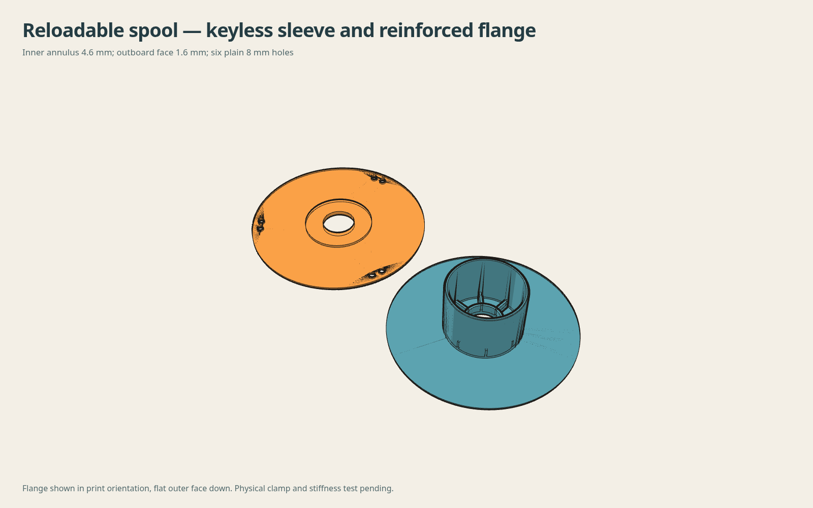

# Keyless sleeve and reinforced removable flange

This revision addresses the owner's reported core-notch interference and flange dishing under the nut. The sleeve key is removed, so either cardboard-core face can sit against the gear-side backing. Torque transfer relies on clamping the cardboard between the faces; slip resistance remains a physical test.

The flange is 4.6 mm thick between its 18.275 mm bore radius and 38.45 mm reinforcement radius. The extra 3 mm projects inward into the empty core, leaving 0.40 mm radial clearance inside the sleeve. Nut and cardboard contact faces, shaft clearance and axial stack are unchanged. The outboard face remains 1.6 mm; outer ribs are removed. Six plain perpendicular 8 mm holes form three pairs 120 degrees apart at radius 91 mm, with 12 mm pair pitch.

## Print files

| Part | STEP | STL | Geometry-only 3MF |
|---|---|---|---|
| Keyless backing/sleeve | [STEP](artifacts/backing-sleeve-keyless.step) | [STL](artifacts/backing-sleeve-keyless.stl) | [3MF](artifacts/backing-sleeve-keyless.3mf) |
| Reinforced flange | [STEP](artifacts/removable-flange-stiff-annulus.step) | [STL](artifacts/removable-flange-stiff-annulus.stl) | [3MF](artifacts/removable-flange-stiff-annulus.3mf) |

Print in the supplied orientation: backing flat with sleeve up; removable flange flat outer face down with the annular reinforcement up. Installed-coordinate STEP files are references, not print orientation. Use the unchanged eight-spoke gear and inverted original nut. Keep refill bands until the flanges secure the refill.

## Evidence and limits

[Native checks](CHECKS.json) cover single-solid validity, STEP readback, protected contact surfaces and added-part interference for 60, 61.2 and 62.4 mm core widths. [Export checks](EXPORT-CHECKS.json) cover closed meshes, bed orientation and actual gear, nut and tightening-tool interference. The tiny nut contact overlap (0.010968 mm³) is the unchanged source float32 contact artifact, not added interference.

Installed OEM drive clearance, real core tolerances, clamp slip and physical stiffness remain unverified. Thickening targets the reported dishing load path; it is not a measured strength rating. Prior assembly illustrations elsewhere show the old keyed/ribbed prototype and do not depict this revision.

## Rebuild

From this directory in the existing CAD environment, run `python build.py` then `python verify.py`. Scripts use the retained original package two directories above; the gear is resolved by that package's source helper. No package installation is performed. `SHA256SUMS` records the revised exports. Original source and accepted body/gear files are preserved.
