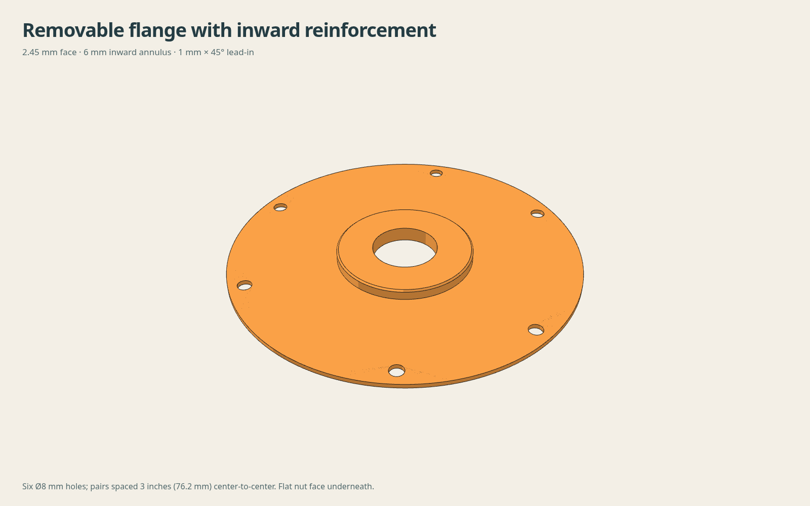

# Uniform removable flange, 2.45 mm skin

Owner requested a uniform outer ring sized to approximately 1.5 times the old ribbed flange stiffness. This revision keeps the inward 6 mm annulus with a 1 mm × 45° outer tip chamfer and six plain 8 mm holes in three pairs, 76.2 mm (3 inches) center-to-center within each pair. The core contact plane remains fixed. The nut face moves outward 0.85 mm, so the nominal 11.9 mm axial thread overlap becomes 11.05 mm. Central thickness is 8.45 mm. The flat nut face is the print bed face.

## Section calculation

At the twelve ribs’ inner radius of 54 mm, each rib has a circumferential skin width b = 2πr/12 = 28.2743 mm. Skin thickness is 1.6 mm; the rib above it is 2 mm wide and 2 mm tall. The area-weighted neutral axis is 0.946226 mm above the skin underside. Summing each rectangle’s centroidal second moment and parallel-axis term gives I = 22.89148 mm^4. A uniform section has I = b t^3 / 12. Setting this to 1.5 times the original gives t = 2.44259 mm; rounded up to 2.45 mm, the section ratio is 1.51369 approximately. The rib fraction decreases toward the rim, so R54 governs this radial-sector calculation.

This assumes common radial curvature across each sector and equal homogeneous solid material. It estimates distributed radial bending. The original continuous raised outer rim is 3.6 mm thick: local rim/hoop stiffness is not guaranteed to increase. Holes, print structure, cardboard and nut compliance are omitted. No physical stiffness or strength certification is claimed.

## Downloads

| Part | STEP | STL | Geometry-only 3MF |
|---|---|---|---|
| Revised removable flange | [STEP](artifacts/removable-flange-stiff-annulus.step) | [STL](artifacts/removable-flange-stiff-annulus.stl) | [3MF](artifacts/removable-flange-stiff-annulus.3mf) |
| Keyless backing and sleeve | [STEP](artifacts/backing-sleeve-keyless.step) | [STL](artifacts/backing-sleeve-keyless.stl) | [3MF](artifacts/backing-sleeve-keyless.3mf) |

Use the unchanged [eight-spoke gear](../../../gear/) and original inverted nut. Keep refill bands intact until the flanges secure the refill. The six holes are plain perpendicular bores at radius 91 mm; only the reinforcement tip has a chamfer. The reinforcement retains 0.40 mm radial sleeve clearance, increasing to 1.40 mm at its chamfered tip.

## Files

artifacts/removable-flange-stiff-annulus.step, .stl and .3mf are the updated flange in flat-bed orientation. The keyless sleeve is unchanged. Original releases are preserved. CHECKS.json and EXPORT-CHECKS.json record geometry and export checks. STIFFNESS.json records the calculation. No slicing or printing was performed.

## Rebuild and validation

Run `python build.py` and `python verify.py` from this revision directory in an existing environment with the repository CAD dependencies. The scripts use the retained original spool package two directories above. No dependencies are installed by the scripts.

The native solids, STEP readback and closed meshes pass. Added parts have zero interference for nominal core widths 60, 61.2 and 62.4 mm. The nut contact retains the original 0.010968 mm³ float32 overlap artifact; there is no new gear/tool interference. Nut and tool placement is shifted outward 0.85 mm for this check. The quoted thread overlap is axial overlap, not a new helical-motion certification.

Installed OEM drive clearance, real cardboard fit, clamp friction and physical stiffness remain unverified. This is a prototype revision. Prior revisions remain available separately.
