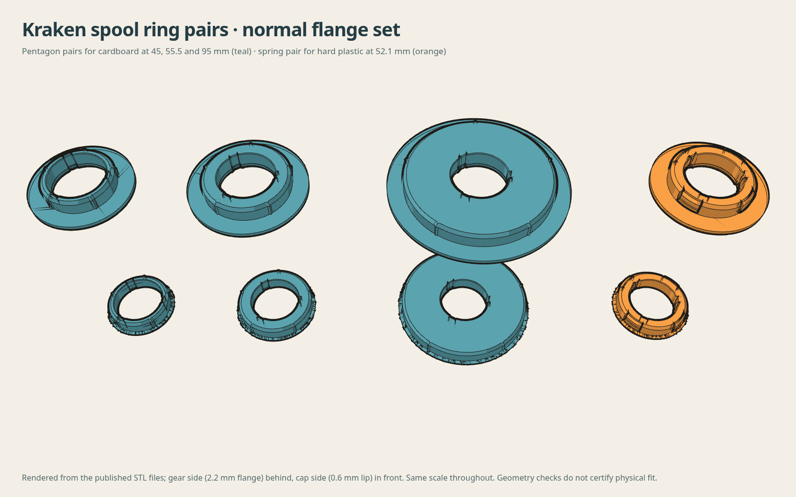

# Pentagon pairs for cardboard spools — every stock size

A matched gear-side and cap-side centering ring for **each original Kraken size from 45 through 95 mm**, in 1 mm steps. These extend the design of the [55.5 mm pair](../README.md); they are new generated sizes, not claims of physical fit on 51 different spools.

Choose the nominal size from the spool's measured centre hole. Each pair uses that size's original humebeam holder bore and snap geometry; these interfaces are not scaled with the outside diameter. The five outer corners bite into cardboard. For hard plastic hubs use the [spring pairs](../hard-spool/README.md).



## Shared dimensions

| Parameter | Value |
|---|---:|
| Round support radius | Nominal hole radius − 0.10 mm |
| Five corner radius | Nominal hole radius + 0.70 mm |
| Corner phase | First corner at +Y; 72° spacing |
| Lead-in | Last 2.0 mm, reducing corner radius by 1.9 mm |
| Gear-side flange | Normal 2.2 mm, skinny 0.4 mm thick; 10.25 mm radial reach beyond nominal hole |
| Gear flange outside diameter | Nominal hole diameter + 20.5 mm |
| Cap-side lip | Normal 0.6 mm, skinny 0.4 mm (the source lip), source lip outline |
| Insertion length | Retained from the corresponding source ring |

**Flange sets.** *Normal*: 2.2 mm gear-side flange and 0.6 mm cap-side lip. *Skinny*: 0.4 mm on both sides, for holders where the extra 2.0 mm of stack does not fit. humebeam's original 0.4 mm cap lip tends to break during bed removal and handling, which is why normal thickens it. The spigot of each side rises by the added base thickness, so it still inserts as deep as the stock ring. A thicker gear-side flange moves the spool seating face away from the gear by the same amount; it does not move the bearing-located gear away from the body wall.

## Downloads

Download **both sides in your chosen size and set**. 3MF files contain geometry only, in millimetres, with the flange or lip on Z0. STL is also supplied. STEP files are gzip-compressed: decompress `.step.gz` before importing into CAD. They are faceted solids with 0.00001 mm numerical topology cleanup, not smooth native CAD or increased mesh resolution.

### Normal set · 2.2 mm gear flange, 0.6 mm cap lip

| Nominal hole | Gear side | Cap side |
|---|---|---|
| 45 mm | [3MF](models/kraken-spool-ring-45-mm-pentagon-gear-side-2.2mm-flange.3mf) · [STL](models/kraken-spool-ring-45-mm-pentagon-gear-side-2.2mm-flange.stl) · [STEP.gz](https://github.com/thereprocase/kraken-remix-ogAMS/releases/download/rings-2026-10-28/kraken-spool-ring-45-mm-pentagon-gear-side-2.2mm-flange.step.gz) | [3MF](models/kraken-spool-ring-45-mm-pentagon-cap-side-0.6mm-lip.3mf) · [STL](models/kraken-spool-ring-45-mm-pentagon-cap-side-0.6mm-lip.stl) · [STEP.gz](https://github.com/thereprocase/kraken-remix-ogAMS/releases/download/rings-2026-10-28/kraken-spool-ring-45-mm-pentagon-cap-side-0.6mm-lip.step.gz) |
| 46 mm | [3MF](models/kraken-spool-ring-46-mm-pentagon-gear-side-2.2mm-flange.3mf) · [STL](models/kraken-spool-ring-46-mm-pentagon-gear-side-2.2mm-flange.stl) · [STEP.gz](https://github.com/thereprocase/kraken-remix-ogAMS/releases/download/rings-2026-10-28/kraken-spool-ring-46-mm-pentagon-gear-side-2.2mm-flange.step.gz) | [3MF](models/kraken-spool-ring-46-mm-pentagon-cap-side-0.6mm-lip.3mf) · [STL](models/kraken-spool-ring-46-mm-pentagon-cap-side-0.6mm-lip.stl) · [STEP.gz](https://github.com/thereprocase/kraken-remix-ogAMS/releases/download/rings-2026-10-28/kraken-spool-ring-46-mm-pentagon-cap-side-0.6mm-lip.step.gz) |
| 47 mm | [3MF](models/kraken-spool-ring-47-mm-pentagon-gear-side-2.2mm-flange.3mf) · [STL](models/kraken-spool-ring-47-mm-pentagon-gear-side-2.2mm-flange.stl) · [STEP.gz](https://github.com/thereprocase/kraken-remix-ogAMS/releases/download/rings-2026-10-28/kraken-spool-ring-47-mm-pentagon-gear-side-2.2mm-flange.step.gz) | [3MF](models/kraken-spool-ring-47-mm-pentagon-cap-side-0.6mm-lip.3mf) · [STL](models/kraken-spool-ring-47-mm-pentagon-cap-side-0.6mm-lip.stl) · [STEP.gz](https://github.com/thereprocase/kraken-remix-ogAMS/releases/download/rings-2026-10-28/kraken-spool-ring-47-mm-pentagon-cap-side-0.6mm-lip.step.gz) |
| 48 mm | [3MF](models/kraken-spool-ring-48-mm-pentagon-gear-side-2.2mm-flange.3mf) · [STL](models/kraken-spool-ring-48-mm-pentagon-gear-side-2.2mm-flange.stl) · [STEP.gz](https://github.com/thereprocase/kraken-remix-ogAMS/releases/download/rings-2026-10-28/kraken-spool-ring-48-mm-pentagon-gear-side-2.2mm-flange.step.gz) | [3MF](models/kraken-spool-ring-48-mm-pentagon-cap-side-0.6mm-lip.3mf) · [STL](models/kraken-spool-ring-48-mm-pentagon-cap-side-0.6mm-lip.stl) · [STEP.gz](https://github.com/thereprocase/kraken-remix-ogAMS/releases/download/rings-2026-10-28/kraken-spool-ring-48-mm-pentagon-cap-side-0.6mm-lip.step.gz) |
| 49 mm | [3MF](models/kraken-spool-ring-49-mm-pentagon-gear-side-2.2mm-flange.3mf) · [STL](models/kraken-spool-ring-49-mm-pentagon-gear-side-2.2mm-flange.stl) · [STEP.gz](https://github.com/thereprocase/kraken-remix-ogAMS/releases/download/rings-2026-10-28/kraken-spool-ring-49-mm-pentagon-gear-side-2.2mm-flange.step.gz) | [3MF](models/kraken-spool-ring-49-mm-pentagon-cap-side-0.6mm-lip.3mf) · [STL](models/kraken-spool-ring-49-mm-pentagon-cap-side-0.6mm-lip.stl) · [STEP.gz](https://github.com/thereprocase/kraken-remix-ogAMS/releases/download/rings-2026-10-28/kraken-spool-ring-49-mm-pentagon-cap-side-0.6mm-lip.step.gz) |
| 50 mm | [3MF](models/kraken-spool-ring-50-mm-pentagon-gear-side-2.2mm-flange.3mf) · [STL](models/kraken-spool-ring-50-mm-pentagon-gear-side-2.2mm-flange.stl) · [STEP.gz](https://github.com/thereprocase/kraken-remix-ogAMS/releases/download/rings-2026-10-28/kraken-spool-ring-50-mm-pentagon-gear-side-2.2mm-flange.step.gz) | [3MF](models/kraken-spool-ring-50-mm-pentagon-cap-side-0.6mm-lip.3mf) · [STL](models/kraken-spool-ring-50-mm-pentagon-cap-side-0.6mm-lip.stl) · [STEP.gz](https://github.com/thereprocase/kraken-remix-ogAMS/releases/download/rings-2026-10-28/kraken-spool-ring-50-mm-pentagon-cap-side-0.6mm-lip.step.gz) |
| 51 mm | [3MF](models/kraken-spool-ring-51-mm-pentagon-gear-side-2.2mm-flange.3mf) · [STL](models/kraken-spool-ring-51-mm-pentagon-gear-side-2.2mm-flange.stl) · [STEP.gz](https://github.com/thereprocase/kraken-remix-ogAMS/releases/download/rings-2026-10-28/kraken-spool-ring-51-mm-pentagon-gear-side-2.2mm-flange.step.gz) | [3MF](models/kraken-spool-ring-51-mm-pentagon-cap-side-0.6mm-lip.3mf) · [STL](models/kraken-spool-ring-51-mm-pentagon-cap-side-0.6mm-lip.stl) · [STEP.gz](https://github.com/thereprocase/kraken-remix-ogAMS/releases/download/rings-2026-10-28/kraken-spool-ring-51-mm-pentagon-cap-side-0.6mm-lip.step.gz) |
| 52 mm | [3MF](models/kraken-spool-ring-52-mm-pentagon-gear-side-2.2mm-flange.3mf) · [STL](models/kraken-spool-ring-52-mm-pentagon-gear-side-2.2mm-flange.stl) · [STEP.gz](https://github.com/thereprocase/kraken-remix-ogAMS/releases/download/rings-2026-10-28/kraken-spool-ring-52-mm-pentagon-gear-side-2.2mm-flange.step.gz) | [3MF](models/kraken-spool-ring-52-mm-pentagon-cap-side-0.6mm-lip.3mf) · [STL](models/kraken-spool-ring-52-mm-pentagon-cap-side-0.6mm-lip.stl) · [STEP.gz](https://github.com/thereprocase/kraken-remix-ogAMS/releases/download/rings-2026-10-28/kraken-spool-ring-52-mm-pentagon-cap-side-0.6mm-lip.step.gz) |
| 53 mm | [3MF](models/kraken-spool-ring-53-mm-pentagon-gear-side-2.2mm-flange.3mf) · [STL](models/kraken-spool-ring-53-mm-pentagon-gear-side-2.2mm-flange.stl) · [STEP.gz](https://github.com/thereprocase/kraken-remix-ogAMS/releases/download/rings-2026-10-28/kraken-spool-ring-53-mm-pentagon-gear-side-2.2mm-flange.step.gz) | [3MF](models/kraken-spool-ring-53-mm-pentagon-cap-side-0.6mm-lip.3mf) · [STL](models/kraken-spool-ring-53-mm-pentagon-cap-side-0.6mm-lip.stl) · [STEP.gz](https://github.com/thereprocase/kraken-remix-ogAMS/releases/download/rings-2026-10-28/kraken-spool-ring-53-mm-pentagon-cap-side-0.6mm-lip.step.gz) |
| 54 mm | [3MF](models/kraken-spool-ring-54-mm-pentagon-gear-side-2.2mm-flange.3mf) · [STL](models/kraken-spool-ring-54-mm-pentagon-gear-side-2.2mm-flange.stl) · [STEP.gz](https://github.com/thereprocase/kraken-remix-ogAMS/releases/download/rings-2026-10-28/kraken-spool-ring-54-mm-pentagon-gear-side-2.2mm-flange.step.gz) | [3MF](models/kraken-spool-ring-54-mm-pentagon-cap-side-0.6mm-lip.3mf) · [STL](models/kraken-spool-ring-54-mm-pentagon-cap-side-0.6mm-lip.stl) · [STEP.gz](https://github.com/thereprocase/kraken-remix-ogAMS/releases/download/rings-2026-10-28/kraken-spool-ring-54-mm-pentagon-cap-side-0.6mm-lip.step.gz) |
| 55 mm | [3MF](models/kraken-spool-ring-55-mm-pentagon-gear-side-2.2mm-flange.3mf) · [STL](models/kraken-spool-ring-55-mm-pentagon-gear-side-2.2mm-flange.stl) · [STEP.gz](https://github.com/thereprocase/kraken-remix-ogAMS/releases/download/rings-2026-10-28/kraken-spool-ring-55-mm-pentagon-gear-side-2.2mm-flange.step.gz) | [3MF](models/kraken-spool-ring-55-mm-pentagon-cap-side-0.6mm-lip.3mf) · [STL](models/kraken-spool-ring-55-mm-pentagon-cap-side-0.6mm-lip.stl) · [STEP.gz](https://github.com/thereprocase/kraken-remix-ogAMS/releases/download/rings-2026-10-28/kraken-spool-ring-55-mm-pentagon-cap-side-0.6mm-lip.step.gz) |
| 56 mm | [3MF](models/kraken-spool-ring-56-mm-pentagon-gear-side-2.2mm-flange.3mf) · [STL](models/kraken-spool-ring-56-mm-pentagon-gear-side-2.2mm-flange.stl) · [STEP.gz](https://github.com/thereprocase/kraken-remix-ogAMS/releases/download/rings-2026-10-28/kraken-spool-ring-56-mm-pentagon-gear-side-2.2mm-flange.step.gz) | [3MF](models/kraken-spool-ring-56-mm-pentagon-cap-side-0.6mm-lip.3mf) · [STL](models/kraken-spool-ring-56-mm-pentagon-cap-side-0.6mm-lip.stl) · [STEP.gz](https://github.com/thereprocase/kraken-remix-ogAMS/releases/download/rings-2026-10-28/kraken-spool-ring-56-mm-pentagon-cap-side-0.6mm-lip.step.gz) |
| 57 mm | [3MF](models/kraken-spool-ring-57-mm-pentagon-gear-side-2.2mm-flange.3mf) · [STL](models/kraken-spool-ring-57-mm-pentagon-gear-side-2.2mm-flange.stl) · [STEP.gz](https://github.com/thereprocase/kraken-remix-ogAMS/releases/download/rings-2026-10-28/kraken-spool-ring-57-mm-pentagon-gear-side-2.2mm-flange.step.gz) | [3MF](models/kraken-spool-ring-57-mm-pentagon-cap-side-0.6mm-lip.3mf) · [STL](models/kraken-spool-ring-57-mm-pentagon-cap-side-0.6mm-lip.stl) · [STEP.gz](https://github.com/thereprocase/kraken-remix-ogAMS/releases/download/rings-2026-10-28/kraken-spool-ring-57-mm-pentagon-cap-side-0.6mm-lip.step.gz) |
| 58 mm | [3MF](models/kraken-spool-ring-58-mm-pentagon-gear-side-2.2mm-flange.3mf) · [STL](models/kraken-spool-ring-58-mm-pentagon-gear-side-2.2mm-flange.stl) · [STEP.gz](https://github.com/thereprocase/kraken-remix-ogAMS/releases/download/rings-2026-10-28/kraken-spool-ring-58-mm-pentagon-gear-side-2.2mm-flange.step.gz) | [3MF](models/kraken-spool-ring-58-mm-pentagon-cap-side-0.6mm-lip.3mf) · [STL](models/kraken-spool-ring-58-mm-pentagon-cap-side-0.6mm-lip.stl) · [STEP.gz](https://github.com/thereprocase/kraken-remix-ogAMS/releases/download/rings-2026-10-28/kraken-spool-ring-58-mm-pentagon-cap-side-0.6mm-lip.step.gz) |
| 59 mm | [3MF](models/kraken-spool-ring-59-mm-pentagon-gear-side-2.2mm-flange.3mf) · [STL](models/kraken-spool-ring-59-mm-pentagon-gear-side-2.2mm-flange.stl) · [STEP.gz](https://github.com/thereprocase/kraken-remix-ogAMS/releases/download/rings-2026-10-28/kraken-spool-ring-59-mm-pentagon-gear-side-2.2mm-flange.step.gz) | [3MF](models/kraken-spool-ring-59-mm-pentagon-cap-side-0.6mm-lip.3mf) · [STL](models/kraken-spool-ring-59-mm-pentagon-cap-side-0.6mm-lip.stl) · [STEP.gz](https://github.com/thereprocase/kraken-remix-ogAMS/releases/download/rings-2026-10-28/kraken-spool-ring-59-mm-pentagon-cap-side-0.6mm-lip.step.gz) |
| 60 mm | [3MF](models/kraken-spool-ring-60-mm-pentagon-gear-side-2.2mm-flange.3mf) · [STL](models/kraken-spool-ring-60-mm-pentagon-gear-side-2.2mm-flange.stl) · [STEP.gz](https://github.com/thereprocase/kraken-remix-ogAMS/releases/download/rings-2026-10-28/kraken-spool-ring-60-mm-pentagon-gear-side-2.2mm-flange.step.gz) | [3MF](models/kraken-spool-ring-60-mm-pentagon-cap-side-0.6mm-lip.3mf) · [STL](models/kraken-spool-ring-60-mm-pentagon-cap-side-0.6mm-lip.stl) · [STEP.gz](https://github.com/thereprocase/kraken-remix-ogAMS/releases/download/rings-2026-10-28/kraken-spool-ring-60-mm-pentagon-cap-side-0.6mm-lip.step.gz) |
| 61 mm | [3MF](models/kraken-spool-ring-61-mm-pentagon-gear-side-2.2mm-flange.3mf) · [STL](models/kraken-spool-ring-61-mm-pentagon-gear-side-2.2mm-flange.stl) · [STEP.gz](https://github.com/thereprocase/kraken-remix-ogAMS/releases/download/rings-2026-10-28/kraken-spool-ring-61-mm-pentagon-gear-side-2.2mm-flange.step.gz) | [3MF](models/kraken-spool-ring-61-mm-pentagon-cap-side-0.6mm-lip.3mf) · [STL](models/kraken-spool-ring-61-mm-pentagon-cap-side-0.6mm-lip.stl) · [STEP.gz](https://github.com/thereprocase/kraken-remix-ogAMS/releases/download/rings-2026-10-28/kraken-spool-ring-61-mm-pentagon-cap-side-0.6mm-lip.step.gz) |
| 62 mm | [3MF](models/kraken-spool-ring-62-mm-pentagon-gear-side-2.2mm-flange.3mf) · [STL](models/kraken-spool-ring-62-mm-pentagon-gear-side-2.2mm-flange.stl) · [STEP.gz](https://github.com/thereprocase/kraken-remix-ogAMS/releases/download/rings-2026-10-28/kraken-spool-ring-62-mm-pentagon-gear-side-2.2mm-flange.step.gz) | [3MF](models/kraken-spool-ring-62-mm-pentagon-cap-side-0.6mm-lip.3mf) · [STL](models/kraken-spool-ring-62-mm-pentagon-cap-side-0.6mm-lip.stl) · [STEP.gz](https://github.com/thereprocase/kraken-remix-ogAMS/releases/download/rings-2026-10-28/kraken-spool-ring-62-mm-pentagon-cap-side-0.6mm-lip.step.gz) |
| 63 mm | [3MF](models/kraken-spool-ring-63-mm-pentagon-gear-side-2.2mm-flange.3mf) · [STL](models/kraken-spool-ring-63-mm-pentagon-gear-side-2.2mm-flange.stl) · [STEP.gz](https://github.com/thereprocase/kraken-remix-ogAMS/releases/download/rings-2026-10-28/kraken-spool-ring-63-mm-pentagon-gear-side-2.2mm-flange.step.gz) | [3MF](models/kraken-spool-ring-63-mm-pentagon-cap-side-0.6mm-lip.3mf) · [STL](models/kraken-spool-ring-63-mm-pentagon-cap-side-0.6mm-lip.stl) · [STEP.gz](https://github.com/thereprocase/kraken-remix-ogAMS/releases/download/rings-2026-10-28/kraken-spool-ring-63-mm-pentagon-cap-side-0.6mm-lip.step.gz) |
| 64 mm | [3MF](models/kraken-spool-ring-64-mm-pentagon-gear-side-2.2mm-flange.3mf) · [STL](models/kraken-spool-ring-64-mm-pentagon-gear-side-2.2mm-flange.stl) · [STEP.gz](https://github.com/thereprocase/kraken-remix-ogAMS/releases/download/rings-2026-10-28/kraken-spool-ring-64-mm-pentagon-gear-side-2.2mm-flange.step.gz) | [3MF](models/kraken-spool-ring-64-mm-pentagon-cap-side-0.6mm-lip.3mf) · [STL](models/kraken-spool-ring-64-mm-pentagon-cap-side-0.6mm-lip.stl) · [STEP.gz](https://github.com/thereprocase/kraken-remix-ogAMS/releases/download/rings-2026-10-28/kraken-spool-ring-64-mm-pentagon-cap-side-0.6mm-lip.step.gz) |
| 65 mm | [3MF](models/kraken-spool-ring-65-mm-pentagon-gear-side-2.2mm-flange.3mf) · [STL](models/kraken-spool-ring-65-mm-pentagon-gear-side-2.2mm-flange.stl) · [STEP.gz](https://github.com/thereprocase/kraken-remix-ogAMS/releases/download/rings-2026-10-28/kraken-spool-ring-65-mm-pentagon-gear-side-2.2mm-flange.step.gz) | [3MF](models/kraken-spool-ring-65-mm-pentagon-cap-side-0.6mm-lip.3mf) · [STL](models/kraken-spool-ring-65-mm-pentagon-cap-side-0.6mm-lip.stl) · [STEP.gz](https://github.com/thereprocase/kraken-remix-ogAMS/releases/download/rings-2026-10-28/kraken-spool-ring-65-mm-pentagon-cap-side-0.6mm-lip.step.gz) |
| 66 mm | [3MF](models/kraken-spool-ring-66-mm-pentagon-gear-side-2.2mm-flange.3mf) · [STL](models/kraken-spool-ring-66-mm-pentagon-gear-side-2.2mm-flange.stl) · [STEP.gz](https://github.com/thereprocase/kraken-remix-ogAMS/releases/download/rings-2026-10-28/kraken-spool-ring-66-mm-pentagon-gear-side-2.2mm-flange.step.gz) | [3MF](models/kraken-spool-ring-66-mm-pentagon-cap-side-0.6mm-lip.3mf) · [STL](models/kraken-spool-ring-66-mm-pentagon-cap-side-0.6mm-lip.stl) · [STEP.gz](https://github.com/thereprocase/kraken-remix-ogAMS/releases/download/rings-2026-10-28/kraken-spool-ring-66-mm-pentagon-cap-side-0.6mm-lip.step.gz) |
| 67 mm | [3MF](models/kraken-spool-ring-67-mm-pentagon-gear-side-2.2mm-flange.3mf) · [STL](models/kraken-spool-ring-67-mm-pentagon-gear-side-2.2mm-flange.stl) · [STEP.gz](https://github.com/thereprocase/kraken-remix-ogAMS/releases/download/rings-2026-10-28/kraken-spool-ring-67-mm-pentagon-gear-side-2.2mm-flange.step.gz) | [3MF](models/kraken-spool-ring-67-mm-pentagon-cap-side-0.6mm-lip.3mf) · [STL](models/kraken-spool-ring-67-mm-pentagon-cap-side-0.6mm-lip.stl) · [STEP.gz](https://github.com/thereprocase/kraken-remix-ogAMS/releases/download/rings-2026-10-28/kraken-spool-ring-67-mm-pentagon-cap-side-0.6mm-lip.step.gz) |
| 68 mm | [3MF](models/kraken-spool-ring-68-mm-pentagon-gear-side-2.2mm-flange.3mf) · [STL](models/kraken-spool-ring-68-mm-pentagon-gear-side-2.2mm-flange.stl) · [STEP.gz](https://github.com/thereprocase/kraken-remix-ogAMS/releases/download/rings-2026-10-28/kraken-spool-ring-68-mm-pentagon-gear-side-2.2mm-flange.step.gz) | [3MF](models/kraken-spool-ring-68-mm-pentagon-cap-side-0.6mm-lip.3mf) · [STL](models/kraken-spool-ring-68-mm-pentagon-cap-side-0.6mm-lip.stl) · [STEP.gz](https://github.com/thereprocase/kraken-remix-ogAMS/releases/download/rings-2026-10-28/kraken-spool-ring-68-mm-pentagon-cap-side-0.6mm-lip.step.gz) |
| 69 mm | [3MF](models/kraken-spool-ring-69-mm-pentagon-gear-side-2.2mm-flange.3mf) · [STL](models/kraken-spool-ring-69-mm-pentagon-gear-side-2.2mm-flange.stl) · [STEP.gz](https://github.com/thereprocase/kraken-remix-ogAMS/releases/download/rings-2026-10-28/kraken-spool-ring-69-mm-pentagon-gear-side-2.2mm-flange.step.gz) | [3MF](models/kraken-spool-ring-69-mm-pentagon-cap-side-0.6mm-lip.3mf) · [STL](models/kraken-spool-ring-69-mm-pentagon-cap-side-0.6mm-lip.stl) · [STEP.gz](https://github.com/thereprocase/kraken-remix-ogAMS/releases/download/rings-2026-10-28/kraken-spool-ring-69-mm-pentagon-cap-side-0.6mm-lip.step.gz) |
| 70 mm | [3MF](models/kraken-spool-ring-70-mm-pentagon-gear-side-2.2mm-flange.3mf) · [STL](models/kraken-spool-ring-70-mm-pentagon-gear-side-2.2mm-flange.stl) · [STEP.gz](https://github.com/thereprocase/kraken-remix-ogAMS/releases/download/rings-2026-10-28/kraken-spool-ring-70-mm-pentagon-gear-side-2.2mm-flange.step.gz) | [3MF](models/kraken-spool-ring-70-mm-pentagon-cap-side-0.6mm-lip.3mf) · [STL](models/kraken-spool-ring-70-mm-pentagon-cap-side-0.6mm-lip.stl) · [STEP.gz](https://github.com/thereprocase/kraken-remix-ogAMS/releases/download/rings-2026-10-28/kraken-spool-ring-70-mm-pentagon-cap-side-0.6mm-lip.step.gz) |
| 71 mm | [3MF](models/kraken-spool-ring-71-mm-pentagon-gear-side-2.2mm-flange.3mf) · [STL](models/kraken-spool-ring-71-mm-pentagon-gear-side-2.2mm-flange.stl) · [STEP.gz](https://github.com/thereprocase/kraken-remix-ogAMS/releases/download/rings-2026-10-28/kraken-spool-ring-71-mm-pentagon-gear-side-2.2mm-flange.step.gz) | [3MF](models/kraken-spool-ring-71-mm-pentagon-cap-side-0.6mm-lip.3mf) · [STL](models/kraken-spool-ring-71-mm-pentagon-cap-side-0.6mm-lip.stl) · [STEP.gz](https://github.com/thereprocase/kraken-remix-ogAMS/releases/download/rings-2026-10-28/kraken-spool-ring-71-mm-pentagon-cap-side-0.6mm-lip.step.gz) |
| 72 mm | [3MF](models/kraken-spool-ring-72-mm-pentagon-gear-side-2.2mm-flange.3mf) · [STL](models/kraken-spool-ring-72-mm-pentagon-gear-side-2.2mm-flange.stl) · [STEP.gz](https://github.com/thereprocase/kraken-remix-ogAMS/releases/download/rings-2026-10-28/kraken-spool-ring-72-mm-pentagon-gear-side-2.2mm-flange.step.gz) | [3MF](models/kraken-spool-ring-72-mm-pentagon-cap-side-0.6mm-lip.3mf) · [STL](models/kraken-spool-ring-72-mm-pentagon-cap-side-0.6mm-lip.stl) · [STEP.gz](https://github.com/thereprocase/kraken-remix-ogAMS/releases/download/rings-2026-10-28/kraken-spool-ring-72-mm-pentagon-cap-side-0.6mm-lip.step.gz) |
| 73 mm | [3MF](models/kraken-spool-ring-73-mm-pentagon-gear-side-2.2mm-flange.3mf) · [STL](models/kraken-spool-ring-73-mm-pentagon-gear-side-2.2mm-flange.stl) · [STEP.gz](https://github.com/thereprocase/kraken-remix-ogAMS/releases/download/rings-2026-10-28/kraken-spool-ring-73-mm-pentagon-gear-side-2.2mm-flange.step.gz) | [3MF](models/kraken-spool-ring-73-mm-pentagon-cap-side-0.6mm-lip.3mf) · [STL](models/kraken-spool-ring-73-mm-pentagon-cap-side-0.6mm-lip.stl) · [STEP.gz](https://github.com/thereprocase/kraken-remix-ogAMS/releases/download/rings-2026-10-28/kraken-spool-ring-73-mm-pentagon-cap-side-0.6mm-lip.step.gz) |
| 74 mm | [3MF](models/kraken-spool-ring-74-mm-pentagon-gear-side-2.2mm-flange.3mf) · [STL](models/kraken-spool-ring-74-mm-pentagon-gear-side-2.2mm-flange.stl) · [STEP.gz](https://github.com/thereprocase/kraken-remix-ogAMS/releases/download/rings-2026-10-28/kraken-spool-ring-74-mm-pentagon-gear-side-2.2mm-flange.step.gz) | [3MF](models/kraken-spool-ring-74-mm-pentagon-cap-side-0.6mm-lip.3mf) · [STL](models/kraken-spool-ring-74-mm-pentagon-cap-side-0.6mm-lip.stl) · [STEP.gz](https://github.com/thereprocase/kraken-remix-ogAMS/releases/download/rings-2026-10-28/kraken-spool-ring-74-mm-pentagon-cap-side-0.6mm-lip.step.gz) |
| 75 mm | [3MF](models/kraken-spool-ring-75-mm-pentagon-gear-side-2.2mm-flange.3mf) · [STL](models/kraken-spool-ring-75-mm-pentagon-gear-side-2.2mm-flange.stl) · [STEP.gz](https://github.com/thereprocase/kraken-remix-ogAMS/releases/download/rings-2026-10-28/kraken-spool-ring-75-mm-pentagon-gear-side-2.2mm-flange.step.gz) | [3MF](models/kraken-spool-ring-75-mm-pentagon-cap-side-0.6mm-lip.3mf) · [STL](models/kraken-spool-ring-75-mm-pentagon-cap-side-0.6mm-lip.stl) · [STEP.gz](https://github.com/thereprocase/kraken-remix-ogAMS/releases/download/rings-2026-10-28/kraken-spool-ring-75-mm-pentagon-cap-side-0.6mm-lip.step.gz) |
| 76 mm | [3MF](models/kraken-spool-ring-76-mm-pentagon-gear-side-2.2mm-flange.3mf) · [STL](models/kraken-spool-ring-76-mm-pentagon-gear-side-2.2mm-flange.stl) · [STEP.gz](https://github.com/thereprocase/kraken-remix-ogAMS/releases/download/rings-2026-10-28/kraken-spool-ring-76-mm-pentagon-gear-side-2.2mm-flange.step.gz) | [3MF](models/kraken-spool-ring-76-mm-pentagon-cap-side-0.6mm-lip.3mf) · [STL](models/kraken-spool-ring-76-mm-pentagon-cap-side-0.6mm-lip.stl) · [STEP.gz](https://github.com/thereprocase/kraken-remix-ogAMS/releases/download/rings-2026-10-28/kraken-spool-ring-76-mm-pentagon-cap-side-0.6mm-lip.step.gz) |
| 77 mm | [3MF](models/kraken-spool-ring-77-mm-pentagon-gear-side-2.2mm-flange.3mf) · [STL](models/kraken-spool-ring-77-mm-pentagon-gear-side-2.2mm-flange.stl) · [STEP.gz](https://github.com/thereprocase/kraken-remix-ogAMS/releases/download/rings-2026-10-28/kraken-spool-ring-77-mm-pentagon-gear-side-2.2mm-flange.step.gz) | [3MF](models/kraken-spool-ring-77-mm-pentagon-cap-side-0.6mm-lip.3mf) · [STL](models/kraken-spool-ring-77-mm-pentagon-cap-side-0.6mm-lip.stl) · [STEP.gz](https://github.com/thereprocase/kraken-remix-ogAMS/releases/download/rings-2026-10-28/kraken-spool-ring-77-mm-pentagon-cap-side-0.6mm-lip.step.gz) |
| 78 mm | [3MF](models/kraken-spool-ring-78-mm-pentagon-gear-side-2.2mm-flange.3mf) · [STL](models/kraken-spool-ring-78-mm-pentagon-gear-side-2.2mm-flange.stl) · [STEP.gz](https://github.com/thereprocase/kraken-remix-ogAMS/releases/download/rings-2026-10-28/kraken-spool-ring-78-mm-pentagon-gear-side-2.2mm-flange.step.gz) | [3MF](models/kraken-spool-ring-78-mm-pentagon-cap-side-0.6mm-lip.3mf) · [STL](models/kraken-spool-ring-78-mm-pentagon-cap-side-0.6mm-lip.stl) · [STEP.gz](https://github.com/thereprocase/kraken-remix-ogAMS/releases/download/rings-2026-10-28/kraken-spool-ring-78-mm-pentagon-cap-side-0.6mm-lip.step.gz) |
| 79 mm | [3MF](models/kraken-spool-ring-79-mm-pentagon-gear-side-2.2mm-flange.3mf) · [STL](models/kraken-spool-ring-79-mm-pentagon-gear-side-2.2mm-flange.stl) · [STEP.gz](https://github.com/thereprocase/kraken-remix-ogAMS/releases/download/rings-2026-10-28/kraken-spool-ring-79-mm-pentagon-gear-side-2.2mm-flange.step.gz) | [3MF](models/kraken-spool-ring-79-mm-pentagon-cap-side-0.6mm-lip.3mf) · [STL](models/kraken-spool-ring-79-mm-pentagon-cap-side-0.6mm-lip.stl) · [STEP.gz](https://github.com/thereprocase/kraken-remix-ogAMS/releases/download/rings-2026-10-28/kraken-spool-ring-79-mm-pentagon-cap-side-0.6mm-lip.step.gz) |
| 80 mm | [3MF](models/kraken-spool-ring-80-mm-pentagon-gear-side-2.2mm-flange.3mf) · [STL](models/kraken-spool-ring-80-mm-pentagon-gear-side-2.2mm-flange.stl) · [STEP.gz](https://github.com/thereprocase/kraken-remix-ogAMS/releases/download/rings-2026-10-28/kraken-spool-ring-80-mm-pentagon-gear-side-2.2mm-flange.step.gz) | [3MF](models/kraken-spool-ring-80-mm-pentagon-cap-side-0.6mm-lip.3mf) · [STL](models/kraken-spool-ring-80-mm-pentagon-cap-side-0.6mm-lip.stl) · [STEP.gz](https://github.com/thereprocase/kraken-remix-ogAMS/releases/download/rings-2026-10-28/kraken-spool-ring-80-mm-pentagon-cap-side-0.6mm-lip.step.gz) |
| 81 mm | [3MF](models/kraken-spool-ring-81-mm-pentagon-gear-side-2.2mm-flange.3mf) · [STL](models/kraken-spool-ring-81-mm-pentagon-gear-side-2.2mm-flange.stl) · [STEP.gz](https://github.com/thereprocase/kraken-remix-ogAMS/releases/download/rings-2026-10-28/kraken-spool-ring-81-mm-pentagon-gear-side-2.2mm-flange.step.gz) | [3MF](models/kraken-spool-ring-81-mm-pentagon-cap-side-0.6mm-lip.3mf) · [STL](models/kraken-spool-ring-81-mm-pentagon-cap-side-0.6mm-lip.stl) · [STEP.gz](https://github.com/thereprocase/kraken-remix-ogAMS/releases/download/rings-2026-10-28/kraken-spool-ring-81-mm-pentagon-cap-side-0.6mm-lip.step.gz) |
| 82 mm | [3MF](models/kraken-spool-ring-82-mm-pentagon-gear-side-2.2mm-flange.3mf) · [STL](models/kraken-spool-ring-82-mm-pentagon-gear-side-2.2mm-flange.stl) · [STEP.gz](https://github.com/thereprocase/kraken-remix-ogAMS/releases/download/rings-2026-10-28/kraken-spool-ring-82-mm-pentagon-gear-side-2.2mm-flange.step.gz) | [3MF](models/kraken-spool-ring-82-mm-pentagon-cap-side-0.6mm-lip.3mf) · [STL](models/kraken-spool-ring-82-mm-pentagon-cap-side-0.6mm-lip.stl) · [STEP.gz](https://github.com/thereprocase/kraken-remix-ogAMS/releases/download/rings-2026-10-28/kraken-spool-ring-82-mm-pentagon-cap-side-0.6mm-lip.step.gz) |
| 83 mm | [3MF](models/kraken-spool-ring-83-mm-pentagon-gear-side-2.2mm-flange.3mf) · [STL](models/kraken-spool-ring-83-mm-pentagon-gear-side-2.2mm-flange.stl) · [STEP.gz](https://github.com/thereprocase/kraken-remix-ogAMS/releases/download/rings-2026-10-28/kraken-spool-ring-83-mm-pentagon-gear-side-2.2mm-flange.step.gz) | [3MF](models/kraken-spool-ring-83-mm-pentagon-cap-side-0.6mm-lip.3mf) · [STL](models/kraken-spool-ring-83-mm-pentagon-cap-side-0.6mm-lip.stl) · [STEP.gz](https://github.com/thereprocase/kraken-remix-ogAMS/releases/download/rings-2026-10-28/kraken-spool-ring-83-mm-pentagon-cap-side-0.6mm-lip.step.gz) |
| 84 mm | [3MF](models/kraken-spool-ring-84-mm-pentagon-gear-side-2.2mm-flange.3mf) · [STL](models/kraken-spool-ring-84-mm-pentagon-gear-side-2.2mm-flange.stl) · [STEP.gz](https://github.com/thereprocase/kraken-remix-ogAMS/releases/download/rings-2026-10-28/kraken-spool-ring-84-mm-pentagon-gear-side-2.2mm-flange.step.gz) | [3MF](models/kraken-spool-ring-84-mm-pentagon-cap-side-0.6mm-lip.3mf) · [STL](models/kraken-spool-ring-84-mm-pentagon-cap-side-0.6mm-lip.stl) · [STEP.gz](https://github.com/thereprocase/kraken-remix-ogAMS/releases/download/rings-2026-10-28/kraken-spool-ring-84-mm-pentagon-cap-side-0.6mm-lip.step.gz) |
| 85 mm | [3MF](models/kraken-spool-ring-85-mm-pentagon-gear-side-2.2mm-flange.3mf) · [STL](models/kraken-spool-ring-85-mm-pentagon-gear-side-2.2mm-flange.stl) · [STEP.gz](https://github.com/thereprocase/kraken-remix-ogAMS/releases/download/rings-2026-10-28/kraken-spool-ring-85-mm-pentagon-gear-side-2.2mm-flange.step.gz) | [3MF](models/kraken-spool-ring-85-mm-pentagon-cap-side-0.6mm-lip.3mf) · [STL](models/kraken-spool-ring-85-mm-pentagon-cap-side-0.6mm-lip.stl) · [STEP.gz](https://github.com/thereprocase/kraken-remix-ogAMS/releases/download/rings-2026-10-28/kraken-spool-ring-85-mm-pentagon-cap-side-0.6mm-lip.step.gz) |
| 86 mm | [3MF](models/kraken-spool-ring-86-mm-pentagon-gear-side-2.2mm-flange.3mf) · [STL](models/kraken-spool-ring-86-mm-pentagon-gear-side-2.2mm-flange.stl) · [STEP.gz](https://github.com/thereprocase/kraken-remix-ogAMS/releases/download/rings-2026-10-28/kraken-spool-ring-86-mm-pentagon-gear-side-2.2mm-flange.step.gz) | [3MF](models/kraken-spool-ring-86-mm-pentagon-cap-side-0.6mm-lip.3mf) · [STL](models/kraken-spool-ring-86-mm-pentagon-cap-side-0.6mm-lip.stl) · [STEP.gz](https://github.com/thereprocase/kraken-remix-ogAMS/releases/download/rings-2026-10-28/kraken-spool-ring-86-mm-pentagon-cap-side-0.6mm-lip.step.gz) |
| 87 mm | [3MF](models/kraken-spool-ring-87-mm-pentagon-gear-side-2.2mm-flange.3mf) · [STL](models/kraken-spool-ring-87-mm-pentagon-gear-side-2.2mm-flange.stl) · [STEP.gz](https://github.com/thereprocase/kraken-remix-ogAMS/releases/download/rings-2026-10-28/kraken-spool-ring-87-mm-pentagon-gear-side-2.2mm-flange.step.gz) | [3MF](models/kraken-spool-ring-87-mm-pentagon-cap-side-0.6mm-lip.3mf) · [STL](models/kraken-spool-ring-87-mm-pentagon-cap-side-0.6mm-lip.stl) · [STEP.gz](https://github.com/thereprocase/kraken-remix-ogAMS/releases/download/rings-2026-10-28/kraken-spool-ring-87-mm-pentagon-cap-side-0.6mm-lip.step.gz) |
| 88 mm | [3MF](models/kraken-spool-ring-88-mm-pentagon-gear-side-2.2mm-flange.3mf) · [STL](models/kraken-spool-ring-88-mm-pentagon-gear-side-2.2mm-flange.stl) · [STEP.gz](https://github.com/thereprocase/kraken-remix-ogAMS/releases/download/rings-2026-10-28/kraken-spool-ring-88-mm-pentagon-gear-side-2.2mm-flange.step.gz) | [3MF](models/kraken-spool-ring-88-mm-pentagon-cap-side-0.6mm-lip.3mf) · [STL](models/kraken-spool-ring-88-mm-pentagon-cap-side-0.6mm-lip.stl) · [STEP.gz](https://github.com/thereprocase/kraken-remix-ogAMS/releases/download/rings-2026-10-28/kraken-spool-ring-88-mm-pentagon-cap-side-0.6mm-lip.step.gz) |
| 89 mm | [3MF](models/kraken-spool-ring-89-mm-pentagon-gear-side-2.2mm-flange.3mf) · [STL](models/kraken-spool-ring-89-mm-pentagon-gear-side-2.2mm-flange.stl) · [STEP.gz](https://github.com/thereprocase/kraken-remix-ogAMS/releases/download/rings-2026-10-28/kraken-spool-ring-89-mm-pentagon-gear-side-2.2mm-flange.step.gz) | [3MF](models/kraken-spool-ring-89-mm-pentagon-cap-side-0.6mm-lip.3mf) · [STL](models/kraken-spool-ring-89-mm-pentagon-cap-side-0.6mm-lip.stl) · [STEP.gz](https://github.com/thereprocase/kraken-remix-ogAMS/releases/download/rings-2026-10-28/kraken-spool-ring-89-mm-pentagon-cap-side-0.6mm-lip.step.gz) |
| 90 mm | [3MF](models/kraken-spool-ring-90-mm-pentagon-gear-side-2.2mm-flange.3mf) · [STL](models/kraken-spool-ring-90-mm-pentagon-gear-side-2.2mm-flange.stl) · [STEP.gz](https://github.com/thereprocase/kraken-remix-ogAMS/releases/download/rings-2026-10-28/kraken-spool-ring-90-mm-pentagon-gear-side-2.2mm-flange.step.gz) | [3MF](models/kraken-spool-ring-90-mm-pentagon-cap-side-0.6mm-lip.3mf) · [STL](models/kraken-spool-ring-90-mm-pentagon-cap-side-0.6mm-lip.stl) · [STEP.gz](https://github.com/thereprocase/kraken-remix-ogAMS/releases/download/rings-2026-10-28/kraken-spool-ring-90-mm-pentagon-cap-side-0.6mm-lip.step.gz) |
| 91 mm | [3MF](models/kraken-spool-ring-91-mm-pentagon-gear-side-2.2mm-flange.3mf) · [STL](models/kraken-spool-ring-91-mm-pentagon-gear-side-2.2mm-flange.stl) · [STEP.gz](https://github.com/thereprocase/kraken-remix-ogAMS/releases/download/rings-2026-10-28/kraken-spool-ring-91-mm-pentagon-gear-side-2.2mm-flange.step.gz) | [3MF](models/kraken-spool-ring-91-mm-pentagon-cap-side-0.6mm-lip.3mf) · [STL](models/kraken-spool-ring-91-mm-pentagon-cap-side-0.6mm-lip.stl) · [STEP.gz](https://github.com/thereprocase/kraken-remix-ogAMS/releases/download/rings-2026-10-28/kraken-spool-ring-91-mm-pentagon-cap-side-0.6mm-lip.step.gz) |
| 92 mm | [3MF](models/kraken-spool-ring-92-mm-pentagon-gear-side-2.2mm-flange.3mf) · [STL](models/kraken-spool-ring-92-mm-pentagon-gear-side-2.2mm-flange.stl) · [STEP.gz](https://github.com/thereprocase/kraken-remix-ogAMS/releases/download/rings-2026-10-28/kraken-spool-ring-92-mm-pentagon-gear-side-2.2mm-flange.step.gz) | [3MF](models/kraken-spool-ring-92-mm-pentagon-cap-side-0.6mm-lip.3mf) · [STL](models/kraken-spool-ring-92-mm-pentagon-cap-side-0.6mm-lip.stl) · [STEP.gz](https://github.com/thereprocase/kraken-remix-ogAMS/releases/download/rings-2026-10-28/kraken-spool-ring-92-mm-pentagon-cap-side-0.6mm-lip.step.gz) |
| 93 mm | [3MF](models/kraken-spool-ring-93-mm-pentagon-gear-side-2.2mm-flange.3mf) · [STL](models/kraken-spool-ring-93-mm-pentagon-gear-side-2.2mm-flange.stl) · [STEP.gz](https://github.com/thereprocase/kraken-remix-ogAMS/releases/download/rings-2026-10-28/kraken-spool-ring-93-mm-pentagon-gear-side-2.2mm-flange.step.gz) | [3MF](models/kraken-spool-ring-93-mm-pentagon-cap-side-0.6mm-lip.3mf) · [STL](models/kraken-spool-ring-93-mm-pentagon-cap-side-0.6mm-lip.stl) · [STEP.gz](https://github.com/thereprocase/kraken-remix-ogAMS/releases/download/rings-2026-10-28/kraken-spool-ring-93-mm-pentagon-cap-side-0.6mm-lip.step.gz) |
| 94 mm | [3MF](models/kraken-spool-ring-94-mm-pentagon-gear-side-2.2mm-flange.3mf) · [STL](models/kraken-spool-ring-94-mm-pentagon-gear-side-2.2mm-flange.stl) · [STEP.gz](https://github.com/thereprocase/kraken-remix-ogAMS/releases/download/rings-2026-10-28/kraken-spool-ring-94-mm-pentagon-gear-side-2.2mm-flange.step.gz) | [3MF](models/kraken-spool-ring-94-mm-pentagon-cap-side-0.6mm-lip.3mf) · [STL](models/kraken-spool-ring-94-mm-pentagon-cap-side-0.6mm-lip.stl) · [STEP.gz](https://github.com/thereprocase/kraken-remix-ogAMS/releases/download/rings-2026-10-28/kraken-spool-ring-94-mm-pentagon-cap-side-0.6mm-lip.step.gz) |
| 95 mm | [3MF](models/kraken-spool-ring-95-mm-pentagon-gear-side-2.2mm-flange.3mf) · [STL](models/kraken-spool-ring-95-mm-pentagon-gear-side-2.2mm-flange.stl) · [STEP.gz](https://github.com/thereprocase/kraken-remix-ogAMS/releases/download/rings-2026-10-28/kraken-spool-ring-95-mm-pentagon-gear-side-2.2mm-flange.step.gz) | [3MF](models/kraken-spool-ring-95-mm-pentagon-cap-side-0.6mm-lip.3mf) · [STL](models/kraken-spool-ring-95-mm-pentagon-cap-side-0.6mm-lip.stl) · [STEP.gz](https://github.com/thereprocase/kraken-remix-ogAMS/releases/download/rings-2026-10-28/kraken-spool-ring-95-mm-pentagon-cap-side-0.6mm-lip.step.gz) |

[All 51 normal pairs as STL + 3MF in one ZIP](https://github.com/thereprocase/kraken-remix-ogAMS/releases/download/rings-2026-10-28/pentagon-stock-sizes-normal-stl-3mf.zip).

### Skinny set · 0.4 mm gear flange and cap lip

| Nominal hole | Gear side | Cap side |
|---|---|---|
| 45 mm | [3MF](models-skinny/kraken-spool-ring-45-mm-pentagon-gear-side-0.4mm-flange.3mf) · [STL](models-skinny/kraken-spool-ring-45-mm-pentagon-gear-side-0.4mm-flange.stl) · [STEP.gz](https://github.com/thereprocase/kraken-remix-ogAMS/releases/download/rings-2026-10-28/kraken-spool-ring-45-mm-pentagon-gear-side-0.4mm-flange.step.gz) | [3MF](models-skinny/kraken-spool-ring-45-mm-pentagon-cap-side-0.4mm-lip.3mf) · [STL](models-skinny/kraken-spool-ring-45-mm-pentagon-cap-side-0.4mm-lip.stl) · [STEP.gz](https://github.com/thereprocase/kraken-remix-ogAMS/releases/download/rings-2026-10-28/kraken-spool-ring-45-mm-pentagon-cap-side-0.4mm-lip.step.gz) |
| 46 mm | [3MF](models-skinny/kraken-spool-ring-46-mm-pentagon-gear-side-0.4mm-flange.3mf) · [STL](models-skinny/kraken-spool-ring-46-mm-pentagon-gear-side-0.4mm-flange.stl) · [STEP.gz](https://github.com/thereprocase/kraken-remix-ogAMS/releases/download/rings-2026-10-28/kraken-spool-ring-46-mm-pentagon-gear-side-0.4mm-flange.step.gz) | [3MF](models-skinny/kraken-spool-ring-46-mm-pentagon-cap-side-0.4mm-lip.3mf) · [STL](models-skinny/kraken-spool-ring-46-mm-pentagon-cap-side-0.4mm-lip.stl) · [STEP.gz](https://github.com/thereprocase/kraken-remix-ogAMS/releases/download/rings-2026-10-28/kraken-spool-ring-46-mm-pentagon-cap-side-0.4mm-lip.step.gz) |
| 47 mm | [3MF](models-skinny/kraken-spool-ring-47-mm-pentagon-gear-side-0.4mm-flange.3mf) · [STL](models-skinny/kraken-spool-ring-47-mm-pentagon-gear-side-0.4mm-flange.stl) · [STEP.gz](https://github.com/thereprocase/kraken-remix-ogAMS/releases/download/rings-2026-10-28/kraken-spool-ring-47-mm-pentagon-gear-side-0.4mm-flange.step.gz) | [3MF](models-skinny/kraken-spool-ring-47-mm-pentagon-cap-side-0.4mm-lip.3mf) · [STL](models-skinny/kraken-spool-ring-47-mm-pentagon-cap-side-0.4mm-lip.stl) · [STEP.gz](https://github.com/thereprocase/kraken-remix-ogAMS/releases/download/rings-2026-10-28/kraken-spool-ring-47-mm-pentagon-cap-side-0.4mm-lip.step.gz) |
| 48 mm | [3MF](models-skinny/kraken-spool-ring-48-mm-pentagon-gear-side-0.4mm-flange.3mf) · [STL](models-skinny/kraken-spool-ring-48-mm-pentagon-gear-side-0.4mm-flange.stl) · [STEP.gz](https://github.com/thereprocase/kraken-remix-ogAMS/releases/download/rings-2026-10-28/kraken-spool-ring-48-mm-pentagon-gear-side-0.4mm-flange.step.gz) | [3MF](models-skinny/kraken-spool-ring-48-mm-pentagon-cap-side-0.4mm-lip.3mf) · [STL](models-skinny/kraken-spool-ring-48-mm-pentagon-cap-side-0.4mm-lip.stl) · [STEP.gz](https://github.com/thereprocase/kraken-remix-ogAMS/releases/download/rings-2026-10-28/kraken-spool-ring-48-mm-pentagon-cap-side-0.4mm-lip.step.gz) |
| 49 mm | [3MF](models-skinny/kraken-spool-ring-49-mm-pentagon-gear-side-0.4mm-flange.3mf) · [STL](models-skinny/kraken-spool-ring-49-mm-pentagon-gear-side-0.4mm-flange.stl) · [STEP.gz](https://github.com/thereprocase/kraken-remix-ogAMS/releases/download/rings-2026-10-28/kraken-spool-ring-49-mm-pentagon-gear-side-0.4mm-flange.step.gz) | [3MF](models-skinny/kraken-spool-ring-49-mm-pentagon-cap-side-0.4mm-lip.3mf) · [STL](models-skinny/kraken-spool-ring-49-mm-pentagon-cap-side-0.4mm-lip.stl) · [STEP.gz](https://github.com/thereprocase/kraken-remix-ogAMS/releases/download/rings-2026-10-28/kraken-spool-ring-49-mm-pentagon-cap-side-0.4mm-lip.step.gz) |
| 50 mm | [3MF](models-skinny/kraken-spool-ring-50-mm-pentagon-gear-side-0.4mm-flange.3mf) · [STL](models-skinny/kraken-spool-ring-50-mm-pentagon-gear-side-0.4mm-flange.stl) · [STEP.gz](https://github.com/thereprocase/kraken-remix-ogAMS/releases/download/rings-2026-10-28/kraken-spool-ring-50-mm-pentagon-gear-side-0.4mm-flange.step.gz) | [3MF](models-skinny/kraken-spool-ring-50-mm-pentagon-cap-side-0.4mm-lip.3mf) · [STL](models-skinny/kraken-spool-ring-50-mm-pentagon-cap-side-0.4mm-lip.stl) · [STEP.gz](https://github.com/thereprocase/kraken-remix-ogAMS/releases/download/rings-2026-10-28/kraken-spool-ring-50-mm-pentagon-cap-side-0.4mm-lip.step.gz) |
| 51 mm | [3MF](models-skinny/kraken-spool-ring-51-mm-pentagon-gear-side-0.4mm-flange.3mf) · [STL](models-skinny/kraken-spool-ring-51-mm-pentagon-gear-side-0.4mm-flange.stl) · [STEP.gz](https://github.com/thereprocase/kraken-remix-ogAMS/releases/download/rings-2026-10-28/kraken-spool-ring-51-mm-pentagon-gear-side-0.4mm-flange.step.gz) | [3MF](models-skinny/kraken-spool-ring-51-mm-pentagon-cap-side-0.4mm-lip.3mf) · [STL](models-skinny/kraken-spool-ring-51-mm-pentagon-cap-side-0.4mm-lip.stl) · [STEP.gz](https://github.com/thereprocase/kraken-remix-ogAMS/releases/download/rings-2026-10-28/kraken-spool-ring-51-mm-pentagon-cap-side-0.4mm-lip.step.gz) |
| 52 mm | [3MF](models-skinny/kraken-spool-ring-52-mm-pentagon-gear-side-0.4mm-flange.3mf) · [STL](models-skinny/kraken-spool-ring-52-mm-pentagon-gear-side-0.4mm-flange.stl) · [STEP.gz](https://github.com/thereprocase/kraken-remix-ogAMS/releases/download/rings-2026-10-28/kraken-spool-ring-52-mm-pentagon-gear-side-0.4mm-flange.step.gz) | [3MF](models-skinny/kraken-spool-ring-52-mm-pentagon-cap-side-0.4mm-lip.3mf) · [STL](models-skinny/kraken-spool-ring-52-mm-pentagon-cap-side-0.4mm-lip.stl) · [STEP.gz](https://github.com/thereprocase/kraken-remix-ogAMS/releases/download/rings-2026-10-28/kraken-spool-ring-52-mm-pentagon-cap-side-0.4mm-lip.step.gz) |
| 53 mm | [3MF](models-skinny/kraken-spool-ring-53-mm-pentagon-gear-side-0.4mm-flange.3mf) · [STL](models-skinny/kraken-spool-ring-53-mm-pentagon-gear-side-0.4mm-flange.stl) · [STEP.gz](https://github.com/thereprocase/kraken-remix-ogAMS/releases/download/rings-2026-10-28/kraken-spool-ring-53-mm-pentagon-gear-side-0.4mm-flange.step.gz) | [3MF](models-skinny/kraken-spool-ring-53-mm-pentagon-cap-side-0.4mm-lip.3mf) · [STL](models-skinny/kraken-spool-ring-53-mm-pentagon-cap-side-0.4mm-lip.stl) · [STEP.gz](https://github.com/thereprocase/kraken-remix-ogAMS/releases/download/rings-2026-10-28/kraken-spool-ring-53-mm-pentagon-cap-side-0.4mm-lip.step.gz) |
| 54 mm | [3MF](models-skinny/kraken-spool-ring-54-mm-pentagon-gear-side-0.4mm-flange.3mf) · [STL](models-skinny/kraken-spool-ring-54-mm-pentagon-gear-side-0.4mm-flange.stl) · [STEP.gz](https://github.com/thereprocase/kraken-remix-ogAMS/releases/download/rings-2026-10-28/kraken-spool-ring-54-mm-pentagon-gear-side-0.4mm-flange.step.gz) | [3MF](models-skinny/kraken-spool-ring-54-mm-pentagon-cap-side-0.4mm-lip.3mf) · [STL](models-skinny/kraken-spool-ring-54-mm-pentagon-cap-side-0.4mm-lip.stl) · [STEP.gz](https://github.com/thereprocase/kraken-remix-ogAMS/releases/download/rings-2026-10-28/kraken-spool-ring-54-mm-pentagon-cap-side-0.4mm-lip.step.gz) |
| 55 mm | [3MF](models-skinny/kraken-spool-ring-55-mm-pentagon-gear-side-0.4mm-flange.3mf) · [STL](models-skinny/kraken-spool-ring-55-mm-pentagon-gear-side-0.4mm-flange.stl) · [STEP.gz](https://github.com/thereprocase/kraken-remix-ogAMS/releases/download/rings-2026-10-28/kraken-spool-ring-55-mm-pentagon-gear-side-0.4mm-flange.step.gz) | [3MF](models-skinny/kraken-spool-ring-55-mm-pentagon-cap-side-0.4mm-lip.3mf) · [STL](models-skinny/kraken-spool-ring-55-mm-pentagon-cap-side-0.4mm-lip.stl) · [STEP.gz](https://github.com/thereprocase/kraken-remix-ogAMS/releases/download/rings-2026-10-28/kraken-spool-ring-55-mm-pentagon-cap-side-0.4mm-lip.step.gz) |
| 56 mm | [3MF](models-skinny/kraken-spool-ring-56-mm-pentagon-gear-side-0.4mm-flange.3mf) · [STL](models-skinny/kraken-spool-ring-56-mm-pentagon-gear-side-0.4mm-flange.stl) · [STEP.gz](https://github.com/thereprocase/kraken-remix-ogAMS/releases/download/rings-2026-10-28/kraken-spool-ring-56-mm-pentagon-gear-side-0.4mm-flange.step.gz) | [3MF](models-skinny/kraken-spool-ring-56-mm-pentagon-cap-side-0.4mm-lip.3mf) · [STL](models-skinny/kraken-spool-ring-56-mm-pentagon-cap-side-0.4mm-lip.stl) · [STEP.gz](https://github.com/thereprocase/kraken-remix-ogAMS/releases/download/rings-2026-10-28/kraken-spool-ring-56-mm-pentagon-cap-side-0.4mm-lip.step.gz) |
| 57 mm | [3MF](models-skinny/kraken-spool-ring-57-mm-pentagon-gear-side-0.4mm-flange.3mf) · [STL](models-skinny/kraken-spool-ring-57-mm-pentagon-gear-side-0.4mm-flange.stl) · [STEP.gz](https://github.com/thereprocase/kraken-remix-ogAMS/releases/download/rings-2026-10-28/kraken-spool-ring-57-mm-pentagon-gear-side-0.4mm-flange.step.gz) | [3MF](models-skinny/kraken-spool-ring-57-mm-pentagon-cap-side-0.4mm-lip.3mf) · [STL](models-skinny/kraken-spool-ring-57-mm-pentagon-cap-side-0.4mm-lip.stl) · [STEP.gz](https://github.com/thereprocase/kraken-remix-ogAMS/releases/download/rings-2026-10-28/kraken-spool-ring-57-mm-pentagon-cap-side-0.4mm-lip.step.gz) |
| 58 mm | [3MF](models-skinny/kraken-spool-ring-58-mm-pentagon-gear-side-0.4mm-flange.3mf) · [STL](models-skinny/kraken-spool-ring-58-mm-pentagon-gear-side-0.4mm-flange.stl) · [STEP.gz](https://github.com/thereprocase/kraken-remix-ogAMS/releases/download/rings-2026-10-28/kraken-spool-ring-58-mm-pentagon-gear-side-0.4mm-flange.step.gz) | [3MF](models-skinny/kraken-spool-ring-58-mm-pentagon-cap-side-0.4mm-lip.3mf) · [STL](models-skinny/kraken-spool-ring-58-mm-pentagon-cap-side-0.4mm-lip.stl) · [STEP.gz](https://github.com/thereprocase/kraken-remix-ogAMS/releases/download/rings-2026-10-28/kraken-spool-ring-58-mm-pentagon-cap-side-0.4mm-lip.step.gz) |
| 59 mm | [3MF](models-skinny/kraken-spool-ring-59-mm-pentagon-gear-side-0.4mm-flange.3mf) · [STL](models-skinny/kraken-spool-ring-59-mm-pentagon-gear-side-0.4mm-flange.stl) · [STEP.gz](https://github.com/thereprocase/kraken-remix-ogAMS/releases/download/rings-2026-10-28/kraken-spool-ring-59-mm-pentagon-gear-side-0.4mm-flange.step.gz) | [3MF](models-skinny/kraken-spool-ring-59-mm-pentagon-cap-side-0.4mm-lip.3mf) · [STL](models-skinny/kraken-spool-ring-59-mm-pentagon-cap-side-0.4mm-lip.stl) · [STEP.gz](https://github.com/thereprocase/kraken-remix-ogAMS/releases/download/rings-2026-10-28/kraken-spool-ring-59-mm-pentagon-cap-side-0.4mm-lip.step.gz) |
| 60 mm | [3MF](models-skinny/kraken-spool-ring-60-mm-pentagon-gear-side-0.4mm-flange.3mf) · [STL](models-skinny/kraken-spool-ring-60-mm-pentagon-gear-side-0.4mm-flange.stl) · [STEP.gz](https://github.com/thereprocase/kraken-remix-ogAMS/releases/download/rings-2026-10-28/kraken-spool-ring-60-mm-pentagon-gear-side-0.4mm-flange.step.gz) | [3MF](models-skinny/kraken-spool-ring-60-mm-pentagon-cap-side-0.4mm-lip.3mf) · [STL](models-skinny/kraken-spool-ring-60-mm-pentagon-cap-side-0.4mm-lip.stl) · [STEP.gz](https://github.com/thereprocase/kraken-remix-ogAMS/releases/download/rings-2026-10-28/kraken-spool-ring-60-mm-pentagon-cap-side-0.4mm-lip.step.gz) |
| 61 mm | [3MF](models-skinny/kraken-spool-ring-61-mm-pentagon-gear-side-0.4mm-flange.3mf) · [STL](models-skinny/kraken-spool-ring-61-mm-pentagon-gear-side-0.4mm-flange.stl) · [STEP.gz](https://github.com/thereprocase/kraken-remix-ogAMS/releases/download/rings-2026-10-28/kraken-spool-ring-61-mm-pentagon-gear-side-0.4mm-flange.step.gz) | [3MF](models-skinny/kraken-spool-ring-61-mm-pentagon-cap-side-0.4mm-lip.3mf) · [STL](models-skinny/kraken-spool-ring-61-mm-pentagon-cap-side-0.4mm-lip.stl) · [STEP.gz](https://github.com/thereprocase/kraken-remix-ogAMS/releases/download/rings-2026-10-28/kraken-spool-ring-61-mm-pentagon-cap-side-0.4mm-lip.step.gz) |
| 62 mm | [3MF](models-skinny/kraken-spool-ring-62-mm-pentagon-gear-side-0.4mm-flange.3mf) · [STL](models-skinny/kraken-spool-ring-62-mm-pentagon-gear-side-0.4mm-flange.stl) · [STEP.gz](https://github.com/thereprocase/kraken-remix-ogAMS/releases/download/rings-2026-10-28/kraken-spool-ring-62-mm-pentagon-gear-side-0.4mm-flange.step.gz) | [3MF](models-skinny/kraken-spool-ring-62-mm-pentagon-cap-side-0.4mm-lip.3mf) · [STL](models-skinny/kraken-spool-ring-62-mm-pentagon-cap-side-0.4mm-lip.stl) · [STEP.gz](https://github.com/thereprocase/kraken-remix-ogAMS/releases/download/rings-2026-10-28/kraken-spool-ring-62-mm-pentagon-cap-side-0.4mm-lip.step.gz) |
| 63 mm | [3MF](models-skinny/kraken-spool-ring-63-mm-pentagon-gear-side-0.4mm-flange.3mf) · [STL](models-skinny/kraken-spool-ring-63-mm-pentagon-gear-side-0.4mm-flange.stl) · [STEP.gz](https://github.com/thereprocase/kraken-remix-ogAMS/releases/download/rings-2026-10-28/kraken-spool-ring-63-mm-pentagon-gear-side-0.4mm-flange.step.gz) | [3MF](models-skinny/kraken-spool-ring-63-mm-pentagon-cap-side-0.4mm-lip.3mf) · [STL](models-skinny/kraken-spool-ring-63-mm-pentagon-cap-side-0.4mm-lip.stl) · [STEP.gz](https://github.com/thereprocase/kraken-remix-ogAMS/releases/download/rings-2026-10-28/kraken-spool-ring-63-mm-pentagon-cap-side-0.4mm-lip.step.gz) |
| 64 mm | [3MF](models-skinny/kraken-spool-ring-64-mm-pentagon-gear-side-0.4mm-flange.3mf) · [STL](models-skinny/kraken-spool-ring-64-mm-pentagon-gear-side-0.4mm-flange.stl) · [STEP.gz](https://github.com/thereprocase/kraken-remix-ogAMS/releases/download/rings-2026-10-28/kraken-spool-ring-64-mm-pentagon-gear-side-0.4mm-flange.step.gz) | [3MF](models-skinny/kraken-spool-ring-64-mm-pentagon-cap-side-0.4mm-lip.3mf) · [STL](models-skinny/kraken-spool-ring-64-mm-pentagon-cap-side-0.4mm-lip.stl) · [STEP.gz](https://github.com/thereprocase/kraken-remix-ogAMS/releases/download/rings-2026-10-28/kraken-spool-ring-64-mm-pentagon-cap-side-0.4mm-lip.step.gz) |
| 65 mm | [3MF](models-skinny/kraken-spool-ring-65-mm-pentagon-gear-side-0.4mm-flange.3mf) · [STL](models-skinny/kraken-spool-ring-65-mm-pentagon-gear-side-0.4mm-flange.stl) · [STEP.gz](https://github.com/thereprocase/kraken-remix-ogAMS/releases/download/rings-2026-10-28/kraken-spool-ring-65-mm-pentagon-gear-side-0.4mm-flange.step.gz) | [3MF](models-skinny/kraken-spool-ring-65-mm-pentagon-cap-side-0.4mm-lip.3mf) · [STL](models-skinny/kraken-spool-ring-65-mm-pentagon-cap-side-0.4mm-lip.stl) · [STEP.gz](https://github.com/thereprocase/kraken-remix-ogAMS/releases/download/rings-2026-10-28/kraken-spool-ring-65-mm-pentagon-cap-side-0.4mm-lip.step.gz) |
| 66 mm | [3MF](models-skinny/kraken-spool-ring-66-mm-pentagon-gear-side-0.4mm-flange.3mf) · [STL](models-skinny/kraken-spool-ring-66-mm-pentagon-gear-side-0.4mm-flange.stl) · [STEP.gz](https://github.com/thereprocase/kraken-remix-ogAMS/releases/download/rings-2026-10-28/kraken-spool-ring-66-mm-pentagon-gear-side-0.4mm-flange.step.gz) | [3MF](models-skinny/kraken-spool-ring-66-mm-pentagon-cap-side-0.4mm-lip.3mf) · [STL](models-skinny/kraken-spool-ring-66-mm-pentagon-cap-side-0.4mm-lip.stl) · [STEP.gz](https://github.com/thereprocase/kraken-remix-ogAMS/releases/download/rings-2026-10-28/kraken-spool-ring-66-mm-pentagon-cap-side-0.4mm-lip.step.gz) |
| 67 mm | [3MF](models-skinny/kraken-spool-ring-67-mm-pentagon-gear-side-0.4mm-flange.3mf) · [STL](models-skinny/kraken-spool-ring-67-mm-pentagon-gear-side-0.4mm-flange.stl) · [STEP.gz](https://github.com/thereprocase/kraken-remix-ogAMS/releases/download/rings-2026-10-28/kraken-spool-ring-67-mm-pentagon-gear-side-0.4mm-flange.step.gz) | [3MF](models-skinny/kraken-spool-ring-67-mm-pentagon-cap-side-0.4mm-lip.3mf) · [STL](models-skinny/kraken-spool-ring-67-mm-pentagon-cap-side-0.4mm-lip.stl) · [STEP.gz](https://github.com/thereprocase/kraken-remix-ogAMS/releases/download/rings-2026-10-28/kraken-spool-ring-67-mm-pentagon-cap-side-0.4mm-lip.step.gz) |
| 68 mm | [3MF](models-skinny/kraken-spool-ring-68-mm-pentagon-gear-side-0.4mm-flange.3mf) · [STL](models-skinny/kraken-spool-ring-68-mm-pentagon-gear-side-0.4mm-flange.stl) · [STEP.gz](https://github.com/thereprocase/kraken-remix-ogAMS/releases/download/rings-2026-10-28/kraken-spool-ring-68-mm-pentagon-gear-side-0.4mm-flange.step.gz) | [3MF](models-skinny/kraken-spool-ring-68-mm-pentagon-cap-side-0.4mm-lip.3mf) · [STL](models-skinny/kraken-spool-ring-68-mm-pentagon-cap-side-0.4mm-lip.stl) · [STEP.gz](https://github.com/thereprocase/kraken-remix-ogAMS/releases/download/rings-2026-10-28/kraken-spool-ring-68-mm-pentagon-cap-side-0.4mm-lip.step.gz) |
| 69 mm | [3MF](models-skinny/kraken-spool-ring-69-mm-pentagon-gear-side-0.4mm-flange.3mf) · [STL](models-skinny/kraken-spool-ring-69-mm-pentagon-gear-side-0.4mm-flange.stl) · [STEP.gz](https://github.com/thereprocase/kraken-remix-ogAMS/releases/download/rings-2026-10-28/kraken-spool-ring-69-mm-pentagon-gear-side-0.4mm-flange.step.gz) | [3MF](models-skinny/kraken-spool-ring-69-mm-pentagon-cap-side-0.4mm-lip.3mf) · [STL](models-skinny/kraken-spool-ring-69-mm-pentagon-cap-side-0.4mm-lip.stl) · [STEP.gz](https://github.com/thereprocase/kraken-remix-ogAMS/releases/download/rings-2026-10-28/kraken-spool-ring-69-mm-pentagon-cap-side-0.4mm-lip.step.gz) |
| 70 mm | [3MF](models-skinny/kraken-spool-ring-70-mm-pentagon-gear-side-0.4mm-flange.3mf) · [STL](models-skinny/kraken-spool-ring-70-mm-pentagon-gear-side-0.4mm-flange.stl) · [STEP.gz](https://github.com/thereprocase/kraken-remix-ogAMS/releases/download/rings-2026-10-28/kraken-spool-ring-70-mm-pentagon-gear-side-0.4mm-flange.step.gz) | [3MF](models-skinny/kraken-spool-ring-70-mm-pentagon-cap-side-0.4mm-lip.3mf) · [STL](models-skinny/kraken-spool-ring-70-mm-pentagon-cap-side-0.4mm-lip.stl) · [STEP.gz](https://github.com/thereprocase/kraken-remix-ogAMS/releases/download/rings-2026-10-28/kraken-spool-ring-70-mm-pentagon-cap-side-0.4mm-lip.step.gz) |
| 71 mm | [3MF](models-skinny/kraken-spool-ring-71-mm-pentagon-gear-side-0.4mm-flange.3mf) · [STL](models-skinny/kraken-spool-ring-71-mm-pentagon-gear-side-0.4mm-flange.stl) · [STEP.gz](https://github.com/thereprocase/kraken-remix-ogAMS/releases/download/rings-2026-10-28/kraken-spool-ring-71-mm-pentagon-gear-side-0.4mm-flange.step.gz) | [3MF](models-skinny/kraken-spool-ring-71-mm-pentagon-cap-side-0.4mm-lip.3mf) · [STL](models-skinny/kraken-spool-ring-71-mm-pentagon-cap-side-0.4mm-lip.stl) · [STEP.gz](https://github.com/thereprocase/kraken-remix-ogAMS/releases/download/rings-2026-10-28/kraken-spool-ring-71-mm-pentagon-cap-side-0.4mm-lip.step.gz) |
| 72 mm | [3MF](models-skinny/kraken-spool-ring-72-mm-pentagon-gear-side-0.4mm-flange.3mf) · [STL](models-skinny/kraken-spool-ring-72-mm-pentagon-gear-side-0.4mm-flange.stl) · [STEP.gz](https://github.com/thereprocase/kraken-remix-ogAMS/releases/download/rings-2026-10-28/kraken-spool-ring-72-mm-pentagon-gear-side-0.4mm-flange.step.gz) | [3MF](models-skinny/kraken-spool-ring-72-mm-pentagon-cap-side-0.4mm-lip.3mf) · [STL](models-skinny/kraken-spool-ring-72-mm-pentagon-cap-side-0.4mm-lip.stl) · [STEP.gz](https://github.com/thereprocase/kraken-remix-ogAMS/releases/download/rings-2026-10-28/kraken-spool-ring-72-mm-pentagon-cap-side-0.4mm-lip.step.gz) |
| 73 mm | [3MF](models-skinny/kraken-spool-ring-73-mm-pentagon-gear-side-0.4mm-flange.3mf) · [STL](models-skinny/kraken-spool-ring-73-mm-pentagon-gear-side-0.4mm-flange.stl) · [STEP.gz](https://github.com/thereprocase/kraken-remix-ogAMS/releases/download/rings-2026-10-28/kraken-spool-ring-73-mm-pentagon-gear-side-0.4mm-flange.step.gz) | [3MF](models-skinny/kraken-spool-ring-73-mm-pentagon-cap-side-0.4mm-lip.3mf) · [STL](models-skinny/kraken-spool-ring-73-mm-pentagon-cap-side-0.4mm-lip.stl) · [STEP.gz](https://github.com/thereprocase/kraken-remix-ogAMS/releases/download/rings-2026-10-28/kraken-spool-ring-73-mm-pentagon-cap-side-0.4mm-lip.step.gz) |
| 74 mm | [3MF](models-skinny/kraken-spool-ring-74-mm-pentagon-gear-side-0.4mm-flange.3mf) · [STL](models-skinny/kraken-spool-ring-74-mm-pentagon-gear-side-0.4mm-flange.stl) · [STEP.gz](https://github.com/thereprocase/kraken-remix-ogAMS/releases/download/rings-2026-10-28/kraken-spool-ring-74-mm-pentagon-gear-side-0.4mm-flange.step.gz) | [3MF](models-skinny/kraken-spool-ring-74-mm-pentagon-cap-side-0.4mm-lip.3mf) · [STL](models-skinny/kraken-spool-ring-74-mm-pentagon-cap-side-0.4mm-lip.stl) · [STEP.gz](https://github.com/thereprocase/kraken-remix-ogAMS/releases/download/rings-2026-10-28/kraken-spool-ring-74-mm-pentagon-cap-side-0.4mm-lip.step.gz) |
| 75 mm | [3MF](models-skinny/kraken-spool-ring-75-mm-pentagon-gear-side-0.4mm-flange.3mf) · [STL](models-skinny/kraken-spool-ring-75-mm-pentagon-gear-side-0.4mm-flange.stl) · [STEP.gz](https://github.com/thereprocase/kraken-remix-ogAMS/releases/download/rings-2026-10-28/kraken-spool-ring-75-mm-pentagon-gear-side-0.4mm-flange.step.gz) | [3MF](models-skinny/kraken-spool-ring-75-mm-pentagon-cap-side-0.4mm-lip.3mf) · [STL](models-skinny/kraken-spool-ring-75-mm-pentagon-cap-side-0.4mm-lip.stl) · [STEP.gz](https://github.com/thereprocase/kraken-remix-ogAMS/releases/download/rings-2026-10-28/kraken-spool-ring-75-mm-pentagon-cap-side-0.4mm-lip.step.gz) |
| 76 mm | [3MF](models-skinny/kraken-spool-ring-76-mm-pentagon-gear-side-0.4mm-flange.3mf) · [STL](models-skinny/kraken-spool-ring-76-mm-pentagon-gear-side-0.4mm-flange.stl) · [STEP.gz](https://github.com/thereprocase/kraken-remix-ogAMS/releases/download/rings-2026-10-28/kraken-spool-ring-76-mm-pentagon-gear-side-0.4mm-flange.step.gz) | [3MF](models-skinny/kraken-spool-ring-76-mm-pentagon-cap-side-0.4mm-lip.3mf) · [STL](models-skinny/kraken-spool-ring-76-mm-pentagon-cap-side-0.4mm-lip.stl) · [STEP.gz](https://github.com/thereprocase/kraken-remix-ogAMS/releases/download/rings-2026-10-28/kraken-spool-ring-76-mm-pentagon-cap-side-0.4mm-lip.step.gz) |
| 77 mm | [3MF](models-skinny/kraken-spool-ring-77-mm-pentagon-gear-side-0.4mm-flange.3mf) · [STL](models-skinny/kraken-spool-ring-77-mm-pentagon-gear-side-0.4mm-flange.stl) · [STEP.gz](https://github.com/thereprocase/kraken-remix-ogAMS/releases/download/rings-2026-10-28/kraken-spool-ring-77-mm-pentagon-gear-side-0.4mm-flange.step.gz) | [3MF](models-skinny/kraken-spool-ring-77-mm-pentagon-cap-side-0.4mm-lip.3mf) · [STL](models-skinny/kraken-spool-ring-77-mm-pentagon-cap-side-0.4mm-lip.stl) · [STEP.gz](https://github.com/thereprocase/kraken-remix-ogAMS/releases/download/rings-2026-10-28/kraken-spool-ring-77-mm-pentagon-cap-side-0.4mm-lip.step.gz) |
| 78 mm | [3MF](models-skinny/kraken-spool-ring-78-mm-pentagon-gear-side-0.4mm-flange.3mf) · [STL](models-skinny/kraken-spool-ring-78-mm-pentagon-gear-side-0.4mm-flange.stl) · [STEP.gz](https://github.com/thereprocase/kraken-remix-ogAMS/releases/download/rings-2026-10-28/kraken-spool-ring-78-mm-pentagon-gear-side-0.4mm-flange.step.gz) | [3MF](models-skinny/kraken-spool-ring-78-mm-pentagon-cap-side-0.4mm-lip.3mf) · [STL](models-skinny/kraken-spool-ring-78-mm-pentagon-cap-side-0.4mm-lip.stl) · [STEP.gz](https://github.com/thereprocase/kraken-remix-ogAMS/releases/download/rings-2026-10-28/kraken-spool-ring-78-mm-pentagon-cap-side-0.4mm-lip.step.gz) |
| 79 mm | [3MF](models-skinny/kraken-spool-ring-79-mm-pentagon-gear-side-0.4mm-flange.3mf) · [STL](models-skinny/kraken-spool-ring-79-mm-pentagon-gear-side-0.4mm-flange.stl) · [STEP.gz](https://github.com/thereprocase/kraken-remix-ogAMS/releases/download/rings-2026-10-28/kraken-spool-ring-79-mm-pentagon-gear-side-0.4mm-flange.step.gz) | [3MF](models-skinny/kraken-spool-ring-79-mm-pentagon-cap-side-0.4mm-lip.3mf) · [STL](models-skinny/kraken-spool-ring-79-mm-pentagon-cap-side-0.4mm-lip.stl) · [STEP.gz](https://github.com/thereprocase/kraken-remix-ogAMS/releases/download/rings-2026-10-28/kraken-spool-ring-79-mm-pentagon-cap-side-0.4mm-lip.step.gz) |
| 80 mm | [3MF](models-skinny/kraken-spool-ring-80-mm-pentagon-gear-side-0.4mm-flange.3mf) · [STL](models-skinny/kraken-spool-ring-80-mm-pentagon-gear-side-0.4mm-flange.stl) · [STEP.gz](https://github.com/thereprocase/kraken-remix-ogAMS/releases/download/rings-2026-10-28/kraken-spool-ring-80-mm-pentagon-gear-side-0.4mm-flange.step.gz) | [3MF](models-skinny/kraken-spool-ring-80-mm-pentagon-cap-side-0.4mm-lip.3mf) · [STL](models-skinny/kraken-spool-ring-80-mm-pentagon-cap-side-0.4mm-lip.stl) · [STEP.gz](https://github.com/thereprocase/kraken-remix-ogAMS/releases/download/rings-2026-10-28/kraken-spool-ring-80-mm-pentagon-cap-side-0.4mm-lip.step.gz) |
| 81 mm | [3MF](models-skinny/kraken-spool-ring-81-mm-pentagon-gear-side-0.4mm-flange.3mf) · [STL](models-skinny/kraken-spool-ring-81-mm-pentagon-gear-side-0.4mm-flange.stl) · [STEP.gz](https://github.com/thereprocase/kraken-remix-ogAMS/releases/download/rings-2026-10-28/kraken-spool-ring-81-mm-pentagon-gear-side-0.4mm-flange.step.gz) | [3MF](models-skinny/kraken-spool-ring-81-mm-pentagon-cap-side-0.4mm-lip.3mf) · [STL](models-skinny/kraken-spool-ring-81-mm-pentagon-cap-side-0.4mm-lip.stl) · [STEP.gz](https://github.com/thereprocase/kraken-remix-ogAMS/releases/download/rings-2026-10-28/kraken-spool-ring-81-mm-pentagon-cap-side-0.4mm-lip.step.gz) |
| 82 mm | [3MF](models-skinny/kraken-spool-ring-82-mm-pentagon-gear-side-0.4mm-flange.3mf) · [STL](models-skinny/kraken-spool-ring-82-mm-pentagon-gear-side-0.4mm-flange.stl) · [STEP.gz](https://github.com/thereprocase/kraken-remix-ogAMS/releases/download/rings-2026-10-28/kraken-spool-ring-82-mm-pentagon-gear-side-0.4mm-flange.step.gz) | [3MF](models-skinny/kraken-spool-ring-82-mm-pentagon-cap-side-0.4mm-lip.3mf) · [STL](models-skinny/kraken-spool-ring-82-mm-pentagon-cap-side-0.4mm-lip.stl) · [STEP.gz](https://github.com/thereprocase/kraken-remix-ogAMS/releases/download/rings-2026-10-28/kraken-spool-ring-82-mm-pentagon-cap-side-0.4mm-lip.step.gz) |
| 83 mm | [3MF](models-skinny/kraken-spool-ring-83-mm-pentagon-gear-side-0.4mm-flange.3mf) · [STL](models-skinny/kraken-spool-ring-83-mm-pentagon-gear-side-0.4mm-flange.stl) · [STEP.gz](https://github.com/thereprocase/kraken-remix-ogAMS/releases/download/rings-2026-10-28/kraken-spool-ring-83-mm-pentagon-gear-side-0.4mm-flange.step.gz) | [3MF](models-skinny/kraken-spool-ring-83-mm-pentagon-cap-side-0.4mm-lip.3mf) · [STL](models-skinny/kraken-spool-ring-83-mm-pentagon-cap-side-0.4mm-lip.stl) · [STEP.gz](https://github.com/thereprocase/kraken-remix-ogAMS/releases/download/rings-2026-10-28/kraken-spool-ring-83-mm-pentagon-cap-side-0.4mm-lip.step.gz) |
| 84 mm | [3MF](models-skinny/kraken-spool-ring-84-mm-pentagon-gear-side-0.4mm-flange.3mf) · [STL](models-skinny/kraken-spool-ring-84-mm-pentagon-gear-side-0.4mm-flange.stl) · [STEP.gz](https://github.com/thereprocase/kraken-remix-ogAMS/releases/download/rings-2026-10-28/kraken-spool-ring-84-mm-pentagon-gear-side-0.4mm-flange.step.gz) | [3MF](models-skinny/kraken-spool-ring-84-mm-pentagon-cap-side-0.4mm-lip.3mf) · [STL](models-skinny/kraken-spool-ring-84-mm-pentagon-cap-side-0.4mm-lip.stl) · [STEP.gz](https://github.com/thereprocase/kraken-remix-ogAMS/releases/download/rings-2026-10-28/kraken-spool-ring-84-mm-pentagon-cap-side-0.4mm-lip.step.gz) |
| 85 mm | [3MF](models-skinny/kraken-spool-ring-85-mm-pentagon-gear-side-0.4mm-flange.3mf) · [STL](models-skinny/kraken-spool-ring-85-mm-pentagon-gear-side-0.4mm-flange.stl) · [STEP.gz](https://github.com/thereprocase/kraken-remix-ogAMS/releases/download/rings-2026-10-28/kraken-spool-ring-85-mm-pentagon-gear-side-0.4mm-flange.step.gz) | [3MF](models-skinny/kraken-spool-ring-85-mm-pentagon-cap-side-0.4mm-lip.3mf) · [STL](models-skinny/kraken-spool-ring-85-mm-pentagon-cap-side-0.4mm-lip.stl) · [STEP.gz](https://github.com/thereprocase/kraken-remix-ogAMS/releases/download/rings-2026-10-28/kraken-spool-ring-85-mm-pentagon-cap-side-0.4mm-lip.step.gz) |
| 86 mm | [3MF](models-skinny/kraken-spool-ring-86-mm-pentagon-gear-side-0.4mm-flange.3mf) · [STL](models-skinny/kraken-spool-ring-86-mm-pentagon-gear-side-0.4mm-flange.stl) · [STEP.gz](https://github.com/thereprocase/kraken-remix-ogAMS/releases/download/rings-2026-10-28/kraken-spool-ring-86-mm-pentagon-gear-side-0.4mm-flange.step.gz) | [3MF](models-skinny/kraken-spool-ring-86-mm-pentagon-cap-side-0.4mm-lip.3mf) · [STL](models-skinny/kraken-spool-ring-86-mm-pentagon-cap-side-0.4mm-lip.stl) · [STEP.gz](https://github.com/thereprocase/kraken-remix-ogAMS/releases/download/rings-2026-10-28/kraken-spool-ring-86-mm-pentagon-cap-side-0.4mm-lip.step.gz) |
| 87 mm | [3MF](models-skinny/kraken-spool-ring-87-mm-pentagon-gear-side-0.4mm-flange.3mf) · [STL](models-skinny/kraken-spool-ring-87-mm-pentagon-gear-side-0.4mm-flange.stl) · [STEP.gz](https://github.com/thereprocase/kraken-remix-ogAMS/releases/download/rings-2026-10-28/kraken-spool-ring-87-mm-pentagon-gear-side-0.4mm-flange.step.gz) | [3MF](models-skinny/kraken-spool-ring-87-mm-pentagon-cap-side-0.4mm-lip.3mf) · [STL](models-skinny/kraken-spool-ring-87-mm-pentagon-cap-side-0.4mm-lip.stl) · [STEP.gz](https://github.com/thereprocase/kraken-remix-ogAMS/releases/download/rings-2026-10-28/kraken-spool-ring-87-mm-pentagon-cap-side-0.4mm-lip.step.gz) |
| 88 mm | [3MF](models-skinny/kraken-spool-ring-88-mm-pentagon-gear-side-0.4mm-flange.3mf) · [STL](models-skinny/kraken-spool-ring-88-mm-pentagon-gear-side-0.4mm-flange.stl) · [STEP.gz](https://github.com/thereprocase/kraken-remix-ogAMS/releases/download/rings-2026-10-28/kraken-spool-ring-88-mm-pentagon-gear-side-0.4mm-flange.step.gz) | [3MF](models-skinny/kraken-spool-ring-88-mm-pentagon-cap-side-0.4mm-lip.3mf) · [STL](models-skinny/kraken-spool-ring-88-mm-pentagon-cap-side-0.4mm-lip.stl) · [STEP.gz](https://github.com/thereprocase/kraken-remix-ogAMS/releases/download/rings-2026-10-28/kraken-spool-ring-88-mm-pentagon-cap-side-0.4mm-lip.step.gz) |
| 89 mm | [3MF](models-skinny/kraken-spool-ring-89-mm-pentagon-gear-side-0.4mm-flange.3mf) · [STL](models-skinny/kraken-spool-ring-89-mm-pentagon-gear-side-0.4mm-flange.stl) · [STEP.gz](https://github.com/thereprocase/kraken-remix-ogAMS/releases/download/rings-2026-10-28/kraken-spool-ring-89-mm-pentagon-gear-side-0.4mm-flange.step.gz) | [3MF](models-skinny/kraken-spool-ring-89-mm-pentagon-cap-side-0.4mm-lip.3mf) · [STL](models-skinny/kraken-spool-ring-89-mm-pentagon-cap-side-0.4mm-lip.stl) · [STEP.gz](https://github.com/thereprocase/kraken-remix-ogAMS/releases/download/rings-2026-10-28/kraken-spool-ring-89-mm-pentagon-cap-side-0.4mm-lip.step.gz) |
| 90 mm | [3MF](models-skinny/kraken-spool-ring-90-mm-pentagon-gear-side-0.4mm-flange.3mf) · [STL](models-skinny/kraken-spool-ring-90-mm-pentagon-gear-side-0.4mm-flange.stl) · [STEP.gz](https://github.com/thereprocase/kraken-remix-ogAMS/releases/download/rings-2026-10-28/kraken-spool-ring-90-mm-pentagon-gear-side-0.4mm-flange.step.gz) | [3MF](models-skinny/kraken-spool-ring-90-mm-pentagon-cap-side-0.4mm-lip.3mf) · [STL](models-skinny/kraken-spool-ring-90-mm-pentagon-cap-side-0.4mm-lip.stl) · [STEP.gz](https://github.com/thereprocase/kraken-remix-ogAMS/releases/download/rings-2026-10-28/kraken-spool-ring-90-mm-pentagon-cap-side-0.4mm-lip.step.gz) |
| 91 mm | [3MF](models-skinny/kraken-spool-ring-91-mm-pentagon-gear-side-0.4mm-flange.3mf) · [STL](models-skinny/kraken-spool-ring-91-mm-pentagon-gear-side-0.4mm-flange.stl) · [STEP.gz](https://github.com/thereprocase/kraken-remix-ogAMS/releases/download/rings-2026-10-28/kraken-spool-ring-91-mm-pentagon-gear-side-0.4mm-flange.step.gz) | [3MF](models-skinny/kraken-spool-ring-91-mm-pentagon-cap-side-0.4mm-lip.3mf) · [STL](models-skinny/kraken-spool-ring-91-mm-pentagon-cap-side-0.4mm-lip.stl) · [STEP.gz](https://github.com/thereprocase/kraken-remix-ogAMS/releases/download/rings-2026-10-28/kraken-spool-ring-91-mm-pentagon-cap-side-0.4mm-lip.step.gz) |
| 92 mm | [3MF](models-skinny/kraken-spool-ring-92-mm-pentagon-gear-side-0.4mm-flange.3mf) · [STL](models-skinny/kraken-spool-ring-92-mm-pentagon-gear-side-0.4mm-flange.stl) · [STEP.gz](https://github.com/thereprocase/kraken-remix-ogAMS/releases/download/rings-2026-10-28/kraken-spool-ring-92-mm-pentagon-gear-side-0.4mm-flange.step.gz) | [3MF](models-skinny/kraken-spool-ring-92-mm-pentagon-cap-side-0.4mm-lip.3mf) · [STL](models-skinny/kraken-spool-ring-92-mm-pentagon-cap-side-0.4mm-lip.stl) · [STEP.gz](https://github.com/thereprocase/kraken-remix-ogAMS/releases/download/rings-2026-10-28/kraken-spool-ring-92-mm-pentagon-cap-side-0.4mm-lip.step.gz) |
| 93 mm | [3MF](models-skinny/kraken-spool-ring-93-mm-pentagon-gear-side-0.4mm-flange.3mf) · [STL](models-skinny/kraken-spool-ring-93-mm-pentagon-gear-side-0.4mm-flange.stl) · [STEP.gz](https://github.com/thereprocase/kraken-remix-ogAMS/releases/download/rings-2026-10-28/kraken-spool-ring-93-mm-pentagon-gear-side-0.4mm-flange.step.gz) | [3MF](models-skinny/kraken-spool-ring-93-mm-pentagon-cap-side-0.4mm-lip.3mf) · [STL](models-skinny/kraken-spool-ring-93-mm-pentagon-cap-side-0.4mm-lip.stl) · [STEP.gz](https://github.com/thereprocase/kraken-remix-ogAMS/releases/download/rings-2026-10-28/kraken-spool-ring-93-mm-pentagon-cap-side-0.4mm-lip.step.gz) |
| 94 mm | [3MF](models-skinny/kraken-spool-ring-94-mm-pentagon-gear-side-0.4mm-flange.3mf) · [STL](models-skinny/kraken-spool-ring-94-mm-pentagon-gear-side-0.4mm-flange.stl) · [STEP.gz](https://github.com/thereprocase/kraken-remix-ogAMS/releases/download/rings-2026-10-28/kraken-spool-ring-94-mm-pentagon-gear-side-0.4mm-flange.step.gz) | [3MF](models-skinny/kraken-spool-ring-94-mm-pentagon-cap-side-0.4mm-lip.3mf) · [STL](models-skinny/kraken-spool-ring-94-mm-pentagon-cap-side-0.4mm-lip.stl) · [STEP.gz](https://github.com/thereprocase/kraken-remix-ogAMS/releases/download/rings-2026-10-28/kraken-spool-ring-94-mm-pentagon-cap-side-0.4mm-lip.step.gz) |
| 95 mm | [3MF](models-skinny/kraken-spool-ring-95-mm-pentagon-gear-side-0.4mm-flange.3mf) · [STL](models-skinny/kraken-spool-ring-95-mm-pentagon-gear-side-0.4mm-flange.stl) · [STEP.gz](https://github.com/thereprocase/kraken-remix-ogAMS/releases/download/rings-2026-10-28/kraken-spool-ring-95-mm-pentagon-gear-side-0.4mm-flange.step.gz) | [3MF](models-skinny/kraken-spool-ring-95-mm-pentagon-cap-side-0.4mm-lip.3mf) · [STL](models-skinny/kraken-spool-ring-95-mm-pentagon-cap-side-0.4mm-lip.stl) · [STEP.gz](https://github.com/thereprocase/kraken-remix-ogAMS/releases/download/rings-2026-10-28/kraken-spool-ring-95-mm-pentagon-cap-side-0.4mm-lip.step.gz) |

[All 51 skinny pairs as STL + 3MF in one ZIP](https://github.com/thereprocase/kraken-remix-ogAMS/releases/download/rings-2026-10-28/pentagon-stock-sizes-skinny-stl-3mf.zip). STEP downloads stay individual to keep download sizes manageable.

## Checks and reproduction

[Geometry validation](VALIDATION.json) and [its skinny counterpart](VALIDATION-skinny.json) cover all 204 parts: a single valid mesh, source-interface preservation, the thickened base's source bore section, nominal height, Z0 placement, and STL/3MF export comparisons. [STEP read-back checks](STEP-CHECKS.json) cover the faceted solid exports and disclose numerical cleanup. Neither report certifies physical shrinkage, snap force, cardboard damage or installed spool clearance.

The smallest sizes need a smaller retained-core envelope so the old outer wall does not obstruct the new lead-in. That envelope is derived from the lead-in radius and remains outside the original holder-interface surfaces. The source-interface comparisons still apply.

Rebuild with the [repository dependencies](../../requirements.txt), from the repository root:

```sh
python rings/source/generate_family.py --output pentagon-build
python rings/source/generate_family.py --output pentagon-skinny-build --set skinny
python rings/export_step.py pentagon-step-build --input pentagon-build/models --gzip --workers 2
```

The first command rebuilds every stock size. For a subset, add `--sizes 45 55 95`. Both commands require new output directories. The generators use simple repeated circle/pentagon extrusions and a tapered lead; source meshes preserve the supplied snap and bore surfaces. See [source provenance](../source/README.md).

Original Kraken and stock ring design: **[humebeam](https://www.printables.com/model/1788417-kraken-revolutionary-bambu-lab-ams)**. Remix: **thereprocase**, under [CC BY-NC 4.0](../../LICENSE.md).
